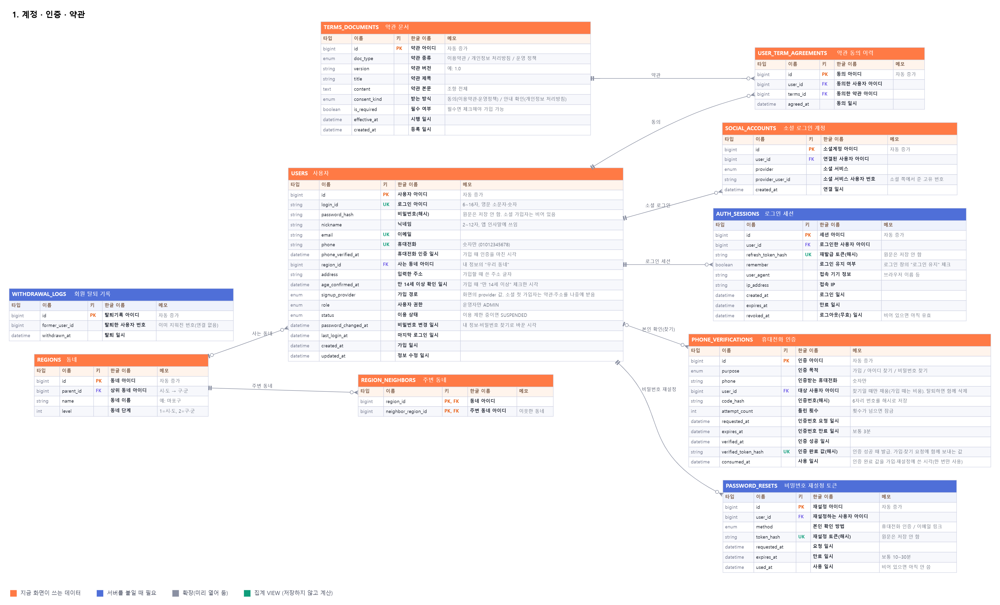
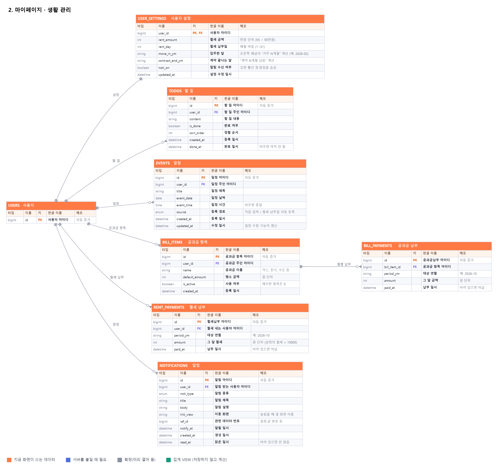
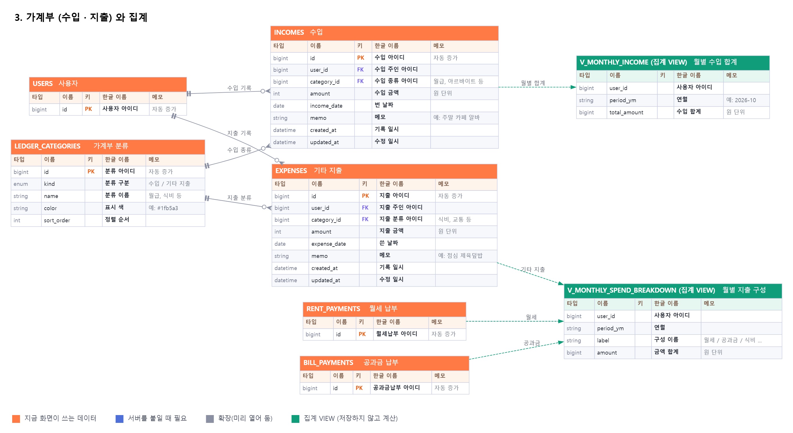
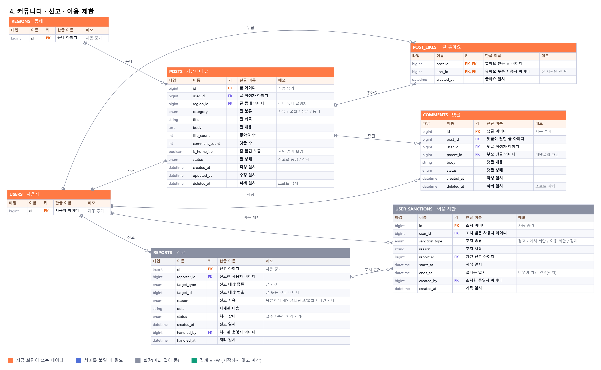
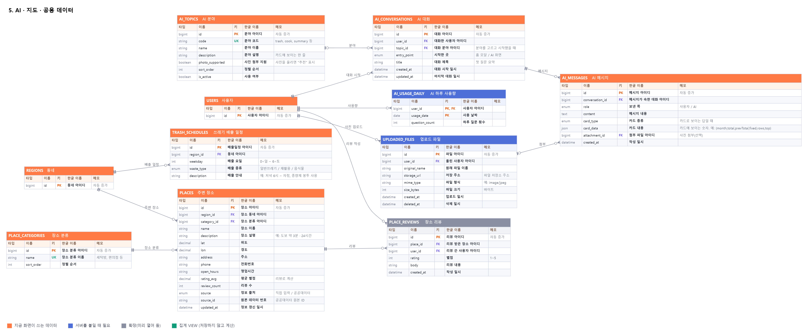

# ZIP 데이터베이스 설계 (현재 프로그램 기준)

> **2026-10-21 SQL 갱신**: 현재 정의는 `schema.sql`이 기준입니다. 기존 ERD PNG에는 아래 변경이 아직 반영되지 않았습니다.
>
> - 소셜 회원의 `users.login_id`에 NULL 허용. 일반 가입 아이디 필수·형식 검사는 서버에서 수행합니다.
> - `post_attachments(post_id, file_id, sort_order)` 추가. `uploaded_files`를 게시글 첨부에도 사용합니다. 최대 5개·합계 2MB와 파일 소유권은 서버에서 검사합니다.
> - `comments.updated_at` 추가, 쓰레기 배출 중복 키를 동네·요일·종류로 확장했습니다.
> - 약관 3종의 제목·본문·버전을 React `frontend/src/features/legal/content.ts`와 통일했습니다. 버전은 `2026-10-18`입니다. 이전 버전의 동의 이력은 보존합니다.
> - 월세 설정은 화면과 같은 **만원 단위**, 월별 납부 금액은 **원 단위**를 유지합니다.
> - AI 사진은 현재 처리 후 보관하지 않습니다. 파일 표·AI 첨부 FK는 향후 저장 기능을 위한 구조이며 현재 사진을 영구 저장하라는 의미가 아닙니다. 실제 저장소 파일 삭제는 서버가 별도로 처리해야 합니다.
>
> **기존 DB 적용**: `schema.sql`의 CREATE TABLE IF NOT EXISTS는 기존 테이블을 변경하지 않습니다. 기존 34개 테이블 설계를 적용한 DB에는 `migrations/20261021_align_current_project.sql`을 **한 번만** 실행하세요. 새 DB에는 `schema.sql`만 실행합니다.
>
> **서버·프론트 연결 시 남은 작업**: 로그인 요청에 remember 전달 및 세션 정책 적용, 월별 월세·공과금 행의 중복 없는 생성(월 중 가입 포함), 과거 지출을 월별 저장 금액으로 계산, React 게시글 타입·API에 첨부파일 연결. DB BIGINT ID는 API에서 문자열로 반환합니다. 아래 기존 설명의 이메일 재설정 흐름은 과거 설명이며, 현재 React는 휴대전화 인증 후 재설정 토큰을 발급받는 방식입니다.

지금 만들어 둔 화면과 기능(`variants/app`, `variants/account`, 시작 화면)이 **실제로 쓰는 데이터**를 기준으로 다시 설계한 DB 입니다.
옛 설계(로그인·커뮤니티 / 생활 관리 / 공용·AI, 표 약 20개)는 아이디·휴대전화 인증, 약관 동의, 가계부, 신고·이용 제한, 지출 요약 카드 같은 지금 기능이 빠져 있어서 이 문서로 대체합니다.

| 항목 | 내용 |
|---|---|
| DB 종류 | MySQL 8.0 이상 (InnoDB, 글자는 utf8mb4) |
| 규모 | 표 **35개** + 집계용 VIEW **2개** |
| 파일 | `schema.sql`(표 만들기 + 기본 데이터), `erd-1 ~ erd-5` PNG(그림), 이 문서(한글 설명) |
| 만드는 법 | `mysql -u root -p < db/schema.sql` → `zip` 데이터베이스가 만들어짐 |

## 1. 그림(ERD) 5장

### 1. 계정 · 인증 · 약관

### 2. 마이페이지 · 생활 관리

### 3. 가계부 (수입 · 지출) 와 집계

### 4. 커뮤니티 · 신고 · 이용 제한

### 5. AI · 지도 · 공용 데이터

> 선 모양: `||`(정확히 하나) — `○<`(0개 이상). 초록 점선은 집계 VIEW 가 그 표를 읽는다는 뜻입니다. 키: **PK** 기본키, **FK** 다른 표를 가리키는 키, **UK** 중복 불가.

## 2. 표 한눈에 보기

### 1. 계정 · 인증 · 약관

| 표 이름 | 한글 이름 | 사용 상태 | 무엇을 담나요 (어느 화면이 쓰나요) |
|---|---|---|---|
| `regions` | 동네 | 지금 화면이 쓰는 데이터 | 시·도와 구·군 같은 "동네" 목록. |
| `region_neighbors` | 주변 동네 | 지금 화면이 쓰는 데이터 | 어느 동네가 어느 동네와 이웃한지 적어 둔 표. |
| `users` | 사용자 | 지금 화면이 쓰는 데이터 | 가입한 사람 한 명당 한 줄. |
| `social_accounts` | 소셜 로그인 계정 | 지금 화면이 쓰는 데이터 | 카카오·구글·네이버로 로그인한 사용자가 어느 소셜 계정인지 연결해 두는 표. |
| `auth_sessions` | 로그인 세션 | 서버를 붙일 때 필요 | 로그인한 기기마다 한 줄. |
| `phone_verifications` | 휴대전화 인증 | 지금 화면이 쓰는 데이터 | 문자로 보낸 인증번호 기록. |
| `password_resets` | 비밀번호 재설정 토큰 | 서버를 붙일 때 필요 | 비밀번호를 다시 정하도록 허락하는 1회용 토큰. |
| `terms_documents` | 약관 문서 | 지금 화면이 쓰는 데이터 | 가입 화면에 보이는 약관의 본문과 버전. |
| `user_term_agreements` | 약관 동의 이력 | 지금 화면이 쓰는 데이터 | 누가 어떤 약관(어느 버전)에 언제 동의했는지 남기는 표. |
| `withdrawal_logs` | 회원 탈퇴 기록 | 서버를 붙일 때 필요 | 탈퇴가 있었다는 사실만 남기는 표(통계·문의 대응용). |

### 2. 마이페이지 · 생활 관리

| 표 이름 | 한글 이름 | 사용 상태 | 무엇을 담나요 (어느 화면이 쓰나요) |
|---|---|---|---|
| `user_settings` | 사용자 설정 | 지금 화면이 쓰는 데이터 | 내 정보 화면의 설정값(월세·월세 납부일·입주한 달·계약 끝나는 달·알림 수신). |
| `todos` | 할 일 | 지금 화면이 쓰는 데이터 | 마이페이지 "할 일" 탭과 오른쪽 패널의 이번 주 할 일 목록. |
| `events` | 일정 | 지금 화면이 쓰는 데이터 | 마이페이지 "일정" 탭의 달력과 일정 목록. |
| `bill_items` | 공과금 항목 | 지금 화면이 쓰는 데이터 | 내가 관리하는 공과금 종류(가스·전기·수도 등)와 평소 금액. |
| `bill_payments` | 공과금 납부 | 지금 화면이 쓰는 데이터 | 공과금 항목별 월별 청구·납부 기록. |
| `rent_payments` | 월세 납부 | 지금 화면이 쓰는 데이터 | 월별 월세 납부 기록. |
| `notifications` | 알림 | 지금 화면이 쓰는 데이터 | 알림 화면과 빨간 점이 쓰는 표. |

### 3. 가계부

| 표 이름 | 한글 이름 | 사용 상태 | 무엇을 담나요 (어느 화면이 쓰나요) |
|---|---|---|---|
| `ledger_categories` | 가계부 분류 | 지금 화면이 쓰는 데이터 | 수입 종류(월급·아르바이트·용돈 등)와 기타 지출 분류(식비·생활용품 등)를 한 표로 관리합니다. |
| `incomes` | 수입 | 지금 화면이 쓰는 데이터 | 가계부 "수입" 탭에서 기록하는 수입 한 건. |
| `expenses` | 기타 지출 | 지금 화면이 쓰는 데이터 | 가계부 "지출 → 기타 지출" 탭에서 기록하는 지출 한 건(식비·생활용품·교통 등). |
| `v_monthly_income` | 월별 수입 합계 (VIEW) | 집계 VIEW | 홈의 "월별 수입" 막대 그래프와 수입 탭의 월 합계. |
| `v_monthly_spend_breakdown` | 월별 지출 구성 (VIEW) | 집계 VIEW | 홈의 "이번 달 지출 구성" 도넛과 AI "이번 달 지출 요약". |

### 4. 커뮤니티 · 신고 · 이용 제한

| 표 이름 | 한글 이름 | 사용 상태 | 무엇을 담나요 (어느 화면이 쓰나요) |
|---|---|---|---|
| `posts` | 커뮤니티 글 | 지금 화면이 쓰는 데이터 | 커뮤니티의 글 한 개. |
| `post_likes` | 글 좋아요 | 지금 화면이 쓰는 데이터 | 누가 어느 글에 좋아요를 눌렀는지. |
| `comments` | 댓글 | 지금 화면이 쓰는 데이터 | 글에 달린 댓글. |
| `reports` | 신고 | 확장(미리 열어 둠) | 운영 정책에 어긋나는 글·댓글을 신고한 기록(정책 제3조). |
| `user_sanctions` | 이용 제한 | 확장(미리 열어 둠) | 운영 정책 위반에 따른 조치 기록(정책 제7조: 경고 → 게시 제한 → 이용 제한 → 이용 정지). |

### 5. AI · 지도 · 공용 데이터

| 표 이름 | 한글 이름 | 사용 상태 | 무엇을 담나요 (어느 화면이 쓰나요) |
|---|---|---|---|
| `ai_topics` | AI 분야 | 지금 화면이 쓰는 데이터 | AI 화면의 분야 카드와 홈 AI 대화 칩의 목록(자유 질문·근처 탐색·분리배출·냉장고 요리·청소·계약·집주인 문자·공과금·지출 요약). |
| `uploaded_files` | 업로드 파일 | 서버를 붙일 때 필요 | 사용자가 올린 사진(AI 상담용). |
| `ai_conversations` | AI 대화 | 지금 화면이 쓰는 데이터 | AI와의 대화 한 건(대화방). |
| `ai_messages` | AI 메시지 | 지금 화면이 쓰는 데이터 | 대화 안의 말풍선 한 개. |
| `ai_usage_daily` | AI 하루 사용량 | 서버를 붙일 때 필요 | 사용자별로 하루에 AI에게 몇 번 질문했는지 세는 표. |
| `trash_schedules` | 쓰레기 배출 일정 | 지금 화면이 쓰는 데이터 | 동네별 요일 배출표. |
| `place_categories` | 장소 분류 | 지금 화면이 쓰는 데이터 | 지도 화면의 칩(세탁방·편의점·약국·마트) 목록. |
| `places` | 주변 장소 | 지금 화면이 쓰는 데이터 | 지도 화면과 AI "근처 탐색"에 나오는 가게·시설. |
| `place_reviews` | 장소 리뷰 | 확장(미리 열어 둠) | 사용자가 장소에 남기는 별점과 한 줄 리뷰(확장 기능). |

## 3. 지금 화면의 저장 값 ↔ DB 표 대응

지금 프로그램은 서버가 없어서 브라우저(`localStorage`)에 저장합니다. 백엔드를 붙일 때 각 값이 어느 표로 가는지 정리했습니다.

| 지금 저장 위치 (localStorage 키 / 파일) | 들어 있는 것 | 옮겨 갈 DB 표 |
|---|---|---|
| `zip-account` + 가입 페이지 입력 | 아이디, 닉네임, 비밀번호 해시, 휴대전화 해시 | `users` (+ `phone_verifications`, 재설정은 `password_resets`) |
| 가입 페이지의 약관 체크 | 서비스 이용약관 · 개인정보 안내 확인 · 운영 정책 동의 | `user_term_agreements` (본문은 `terms_documents`) |
| 로그인 창 / 소셜 로그인 버튼 | 로그인, 카카오·구글·네이버 | `auth_sessions`, `social_accounts` |
| 아이디 찾기 · 비밀번호 찾기 | 휴대전화 인증, 재설정 | `phone_verifications` |
| `zip-settings` | 이름(닉네임), 동네, 월세, 납부일, 알림 | `users`(닉네임·동네) + `user_settings` (React 앱은 입주한 달·계약 끝나는 달도 저장) |
| `zip-todos` | 할 일 | `todos` |
| `zip-events` | 일정 | `events` |
| `zip-bills` | 공과금 항목과 납부 체크 | `bill_items` + `bill_payments` |
| `zip-rent-paid` | 월별 월세 납부 체크 | `rent_payments` |
| `zip-incomes` | 수입 기록 | `incomes` (종류는 `ledger_categories`) |
| `zip-spends` | 기타 지출 기록 | `expenses` (분류는 `ledger_categories`) |
| 홈 월별 수입 그래프 / 이번 달 지출 구성 / AI 지출 요약 | 위 기록을 합산한 값 | 저장하지 않고 VIEW `v_monthly_income`, `v_monthly_spend_breakdown` 로 계산 |
| `zip-noti-read` | 알림을 읽었는지 | `notifications.read_at` |
| `zip-posts` | 커뮤니티 글·좋아요·댓글 | `posts`, `post_likes`, `comments` |
| (아직 없음) 신고, 운영 조치 | 운영 정책 제3조·제7조 | `reports`, `user_sanctions` |
| `zip-ai-chat` | AI 대화 말풍선(지출 요약 카드 포함) | `ai_conversations`, `ai_messages` |
| AI 화면의 분야 카드 | 분야 목록 | `ai_topics` |
| AI 화면의 사진 첨부 | 올린 사진 | `uploaded_files` |
| `variants/app/js/data/trash.js` | 요일별 배출표 | `trash_schedules` |
| `variants/app/js/data/places.js` | 지도의 장소 | `places`, `place_categories` |
| `variants/app/js/data/posts-seed.js` | 동네·주변 동네, 기본 글 | `regions`, `region_neighbors`, `posts` |
| `variants/account/terms.js` | 약관 본문 | `terms_documents` |

### React 앱(`frontend/`)의 저장 위치

| React 저장 위치 | 들어 있는 것 | 옮겨 갈 DB 표 |
|---|---|---|
| `zip-life` (한 곳에 모아 저장) | 할 일, 공과금, 일정, 수입, 지출, 월세 납부 체크, 알림 읽음, 설정(동네·월세·납부일·알림·입주한 달·계약 끝나는 달) | `todos`, `bill_items` + `bill_payments`, `events`, `incomes`, `expenses`, `rent_payments`, `notifications.read_at`, `user_settings` |
| `zip-auth` | 로그인 토큰과 내 정보 (`id, username, email, nickname, address, provider, agreedAt`) | `auth_sessions`, `users` (`provider` = `users.signup_provider`, `agreedAt` = `user_term_agreements`) |
| `zip-mock-users` | 가짜 API가 저장한 가입 계정 | `users` (+ 휴대전화는 `phone_verifications` 로 확인) |
| `zip-posts` | 커뮤니티 글·좋아요·댓글 | `posts`, `post_likes`, `comments` |
| `zip-ai-chat` | AI 대화 말풍선 (지출 요약 카드 `{month,total,prevTotal,fixed,rows,top}` 포함) | `ai_conversations`, `ai_messages` (카드는 `card_data` JSON) |

## 4. 표마다 자세한 설명

각 표의 컬럼은 **이름 / 타입 / 키 / 한글 이름 / 설명 / 비어도 되나요(NULL) / 기본값** 순서입니다.

### 1. 계정 · 인증 · 약관

#### `regions` — 동네

시·도와 구·군 같은 "동네" 목록. 사용자가 사는 동네, 커뮤니티 글의 동네, 쓰레기 배출표, 주변 장소가 모두 이 표를 가리킵니다. (내 정보의 "우리 동네", 커뮤니티의 "우리 동네 / 주변 동네 / 전체" 범위)

사용 상태: **지금 화면이 쓰는 데이터**

| 이름 | 타입 | 키 | 한글 이름 | 설명 | NULL | 기본값 |
|---|---|---|---|---|---|---|
| `id` | BIGINT UNSIGNED | PK | 동네 아이디 | 자동 증가 |  |  |
| `parent_id` | BIGINT UNSIGNED | FK → `regions.id` | 상위 동네 아이디 | 시·도 → 구·군 | ○ |  |
| `name` | VARCHAR(30) |  | 동네 이름 | 예: 마포구 |  |  |
| `level` | TINYINT UNSIGNED |  | 동네 단계 | 1=시·도, 2=구·군 |  |  |

- 중복 불가: parent_id + name
- `parent_id` 는 `regions.id` 를 가리키고, 지워질 때 **삭제 막음**

#### `region_neighbors` — 주변 동네

어느 동네가 어느 동네와 이웃한지 적어 둔 표. 커뮤니티의 "주변 동네" 범위로 글을 모아 볼 때 씁니다. (마포구 ↔ 서대문구·용산구·영등포구)

사용 상태: **지금 화면이 쓰는 데이터**

| 이름 | 타입 | 키 | 한글 이름 | 설명 | NULL | 기본값 |
|---|---|---|---|---|---|---|
| `region_id` | BIGINT UNSIGNED | PK, FK → `regions.id` | 동네 아이디 |  |  |  |
| `neighbor_region_id` | BIGINT UNSIGNED | PK, FK → `regions.id` | 주변 동네 아이디 | 이웃한 동네 |  |  |

- `region_id` 는 `regions.id` 를 가리키고, 지워질 때 **함께 삭제**
- `neighbor_region_id` 는 `regions.id` 를 가리키고, 지워질 때 **함께 삭제**

#### `users` — 사용자

가입한 사람 한 명당 한 줄. 로그인 정보(아이디·비밀번호), 본인 확인 정보(휴대전화·이메일), 닉네임과 사는 동네를 담습니다. 모든 개인 데이터(일정·할 일·가계부·글 등)가 이 표의 id 를 따라갑니다. 회원 탈퇴를 하면 이 줄과 딸린 데이터가 모두 지워집니다.

사용 상태: **지금 화면이 쓰는 데이터**

| 이름 | 타입 | 키 | 한글 이름 | 설명 | NULL | 기본값 |
|---|---|---|---|---|---|---|
| `id` | BIGINT UNSIGNED | PK | 사용자 아이디 | 자동 증가 |  |  |
| `login_id` | VARCHAR(16) | UK | 로그인 아이디 | 일반 가입 필수, 소셜 가입 NULL 허용 | ○ |  |
| `password_hash` | VARCHAR(100) |  | 비밀번호(해시) | 원문은 저장 안 함. 소셜 가입자는 비어 있음 | ○ |  |
| `nickname` | VARCHAR(12) |  | 닉네임 | 2~12자, 앱 인사말에 쓰임 |  |  |
| `email` | VARCHAR(100) | UK | 이메일 |  | ○ |  |
| `phone` | VARCHAR(11) | UK | 휴대전화 | 숫자만 (01012345678) | ○ |  |
| `phone_verified_at` | DATETIME |  | 휴대전화 인증 일시 | 가입 때 인증을 마친 시각 | ○ |  |
| `region_id` | BIGINT UNSIGNED | FK → `regions.id` | 사는 동네 아이디 | 내 정보의 "우리 동네" | ○ |  |
| `address` | VARCHAR(200) |  | 입력한 주소 | 가입할 때 쓴 주소 글자 | ○ |  |
| `age_confirmed_at` | DATETIME |  | 만 14세 이상 확인 일시 | 가입 때 "만 14세 이상" 체크한 시각 | ○ |  |
| `signup_provider` | ENUM('EMAIL','KAKAO','GOOGLE','NAVER') |  | 가입 경로 | 화면의 provider 값. 소셜 첫 가입자는 약관·주소를 나중에 받음 |  | `'EMAIL'` |
| `role` | ENUM('USER','ADMIN') |  | 사용자 권한 | 운영자만 ADMIN |  | `'USER'` |
| `status` | ENUM('ACTIVE','SUSPENDED') |  | 이용 상태 | 이용 제한 중이면 SUSPENDED |  | `'ACTIVE'` |
| `password_changed_at` | DATETIME |  | 비밀번호 변경 일시 | 내 정보·비밀번호 찾기로 바꾼 시각 | ○ |  |
| `last_login_at` | DATETIME |  | 마지막 로그인 일시 |  | ○ |  |
| `created_at` | DATETIME |  | 가입 일시 |  |  | `CURRENT_TIMESTAMP` |
| `updated_at` | DATETIME |  | 정보 수정 일시 |  |  | `CURRENT_TIMESTAMP` |

- `region_id` 는 `regions.id` 를 가리키고, 지워질 때 **비움**

#### `social_accounts` — 소셜 로그인 계정

카카오·구글·네이버로 로그인한 사용자가 어느 소셜 계정인지 연결해 두는 표. 한 사용자가 여러 소셜을 연결할 수 있고, 같은 소셜 계정은 한 사용자에게만 붙습니다.

사용 상태: **지금 화면이 쓰는 데이터**

| 이름 | 타입 | 키 | 한글 이름 | 설명 | NULL | 기본값 |
|---|---|---|---|---|---|---|
| `id` | BIGINT UNSIGNED | PK | 소셜계정 아이디 | 자동 증가 |  |  |
| `user_id` | BIGINT UNSIGNED | FK → `users.id` | 연결된 사용자 아이디 |  |  |  |
| `provider` | ENUM('KAKAO','GOOGLE','NAVER') |  | 소셜 서비스 |  |  |  |
| `provider_user_id` | VARCHAR(100) |  | 소셜 서비스 사용자 번호 | 소셜 쪽에서 준 고유 번호 |  |  |
| `created_at` | DATETIME |  | 연결 일시 |  |  | `CURRENT_TIMESTAMP` |

- 중복 불가: provider + provider_user_id
- 중복 불가: user_id + provider
- `user_id` 는 `users.id` 를 가리키고, 지워질 때 **함께 삭제**

#### `auth_sessions` — 로그인 세션

로그인한 기기마다 한 줄. 토큰 원문 대신 해시만 저장합니다. 로그아웃하면 revoked_at 이 채워지고, "로그인 유지"를 켜면 만료가 길어집니다.

사용 상태: **서버를 붙일 때 필요**

| 이름 | 타입 | 키 | 한글 이름 | 설명 | NULL | 기본값 |
|---|---|---|---|---|---|---|
| `id` | BIGINT UNSIGNED | PK | 세션 아이디 | 자동 증가 |  |  |
| `user_id` | BIGINT UNSIGNED | FK → `users.id` | 로그인한 사용자 아이디 |  |  |  |
| `refresh_token_hash` | CHAR(64) | UK | 재발급 토큰(해시) | 원문은 저장 안 함 |  |  |
| `remember` | TINYINT(1) |  | 로그인 유지 여부 | 로그인 창의 "로그인 유지" 체크 |  | `0` |
| `user_agent` | VARCHAR(255) |  | 접속 기기 정보 | 브라우저 이름 등 | ○ |  |
| `ip_address` | VARCHAR(45) |  | 접속 IP |  | ○ |  |
| `created_at` | DATETIME |  | 로그인 일시 |  |  | `CURRENT_TIMESTAMP` |
| `expires_at` | DATETIME |  | 만료 일시 |  |  |  |
| `revoked_at` | DATETIME |  | 로그아웃(무효) 일시 | 비어 있으면 아직 유효 | ○ |  |

- `user_id` 는 `users.id` 를 가리키고, 지워질 때 **함께 삭제**

#### `phone_verifications` — 휴대전화 인증

문자로 보낸 인증번호 기록. 가입, 아이디 찾기, 비밀번호 찾기에서 같은 방식으로 씁니다. 인증에 성공하면 "인증 완료 값"이 발급되고, 가입 요청(가입 화면의 휴대전화 인증)이나 비밀번호 재설정(password_resets)에 그 값을 함께 보냅니다.

사용 상태: **지금 화면이 쓰는 데이터**

| 이름 | 타입 | 키 | 한글 이름 | 설명 | NULL | 기본값 |
|---|---|---|---|---|---|---|
| `id` | BIGINT UNSIGNED | PK | 인증 아이디 | 자동 증가 |  |  |
| `purpose` | ENUM('SIGNUP','FIND_ID','RESET_PASSWORD') |  | 인증 목적 | 가입 / 아이디 찾기 / 비밀번호 찾기 |  |  |
| `phone` | VARCHAR(11) |  | 인증받는 휴대전화 | 숫자만 |  |  |
| `user_id` | BIGINT UNSIGNED | FK → `users.id` | 대상 사용자 아이디 | 찾기일 때만 채움(가입 때는 비움). 탈퇴하면 함께 삭제 | ○ |  |
| `code_hash` | CHAR(64) |  | 인증번호(해시) | 6자리 번호를 해시로 저장 |  |  |
| `attempt_count` | TINYINT UNSIGNED |  | 틀린 횟수 | 횟수가 넘으면 잠금 |  | `0` |
| `requested_at` | DATETIME |  | 인증번호 요청 일시 |  |  | `CURRENT_TIMESTAMP` |
| `expires_at` | DATETIME |  | 인증번호 만료 일시 | 보통 3분 |  |  |
| `verified_at` | DATETIME |  | 인증 성공 일시 |  | ○ |  |
| `verified_token_hash` | CHAR(64) | UK | 인증 완료 값(해시) | 인증 성공 때 발급. 가입·찾기 요청에 함께 보내는 값 | ○ |  |
| `consumed_at` | DATETIME |  | 사용 일시 | 인증 완료 값을 가입·재설정에 쓴 시각(한 번만 사용) | ○ |  |

- 빨리 찾기용 색인: phone + requested_at
- `user_id` 는 `users.id` 를 가리키고, 지워질 때 **함께 삭제**

#### `password_resets` — 비밀번호 재설정 토큰

비밀번호를 다시 정하도록 허락하는 1회용 토큰. 휴대전화 인증을 통과했을 때(시안의 바로 재설정)와 이메일로 재설정 링크를 보냈을 때(React 앱의 현재 방식) 둘 다 이 표 한 줄로 처리합니다. 토큰은 해시만 저장하고, 한 번 쓰면 used_at 이 채워져 다시 쓸 수 없습니다.

사용 상태: **서버를 붙일 때 필요**

| 이름 | 타입 | 키 | 한글 이름 | 설명 | NULL | 기본값 |
|---|---|---|---|---|---|---|
| `id` | BIGINT UNSIGNED | PK | 재설정 아이디 | 자동 증가 |  |  |
| `user_id` | BIGINT UNSIGNED | FK → `users.id` | 재설정하는 사용자 아이디 |  |  |  |
| `method` | ENUM('PHONE','EMAIL') |  | 본인 확인 방법 | 휴대전화 인증 / 이메일 링크 |  |  |
| `token_hash` | CHAR(64) | UK | 재설정 토큰(해시) | 원문은 저장 안 함 |  |  |
| `requested_at` | DATETIME |  | 요청 일시 |  |  | `CURRENT_TIMESTAMP` |
| `expires_at` | DATETIME |  | 만료 일시 | 보통 10~30분 |  |  |
| `used_at` | DATETIME |  | 사용 일시 | 비어 있으면 아직 안 씀 | ○ |  |

- `user_id` 는 `users.id` 를 가리키고, 지워질 때 **함께 삭제**

#### `terms_documents` — 약관 문서

가입 화면에 보이는 약관의 본문과 버전. 서비스 이용약관, 개인정보 처리방침, 커뮤니티·AI 운영 정책 세 종류이고, 내용이 바뀌면 새 버전 줄을 추가합니다.

사용 상태: **지금 화면이 쓰는 데이터**

| 이름 | 타입 | 키 | 한글 이름 | 설명 | NULL | 기본값 |
|---|---|---|---|---|---|---|
| `id` | BIGINT UNSIGNED | PK | 약관 아이디 | 자동 증가 |  |  |
| `doc_type` | ENUM('SERVICE','PRIVACY','POLICY') |  | 약관 종류 | 이용약관 / 개인정보 처리방침 / 운영 정책 |  |  |
| `version` | VARCHAR(20) |  | 약관 버전 | 예: 2026-10-18 |  |  |
| `title` | VARCHAR(100) |  | 약관 제목 |  |  |  |
| `content` | MEDIUMTEXT |  | 약관 본문 | 조항 전체 |  |  |
| `consent_kind` | ENUM('AGREE','CONFIRM') |  | 받는 방식 | 동의(이용약관·운영정책) / 안내 확인(개인정보 처리방침) |  |  |
| `is_required` | TINYINT(1) |  | 필수 여부 | 필수면 체크해야 가입 가능 |  | `1` |
| `effective_at` | DATETIME |  | 시행 일시 |  |  |  |
| `created_at` | DATETIME |  | 등록 일시 |  |  | `CURRENT_TIMESTAMP` |

- 중복 불가: doc_type + version

#### `user_term_agreements` — 약관 동의 이력

누가 어떤 약관(어느 버전)에 언제 동의했는지 남기는 표. 분쟁이 생기면 증거가 되므로 사용자가 탈퇴하기 전까지 보관합니다.

사용 상태: **지금 화면이 쓰는 데이터**

| 이름 | 타입 | 키 | 한글 이름 | 설명 | NULL | 기본값 |
|---|---|---|---|---|---|---|
| `id` | BIGINT UNSIGNED | PK | 동의 아이디 | 자동 증가 |  |  |
| `user_id` | BIGINT UNSIGNED | FK → `users.id` | 동의한 사용자 아이디 |  |  |  |
| `terms_id` | BIGINT UNSIGNED | FK → `terms_documents.id` | 동의한 약관 아이디 |  |  |  |
| `agreed_at` | DATETIME |  | 동의 일시 |  |  | `CURRENT_TIMESTAMP` |

- 중복 불가: user_id + terms_id
- `user_id` 는 `users.id` 를 가리키고, 지워질 때 **함께 삭제**
- `terms_id` 는 `terms_documents.id` 를 가리키고, 지워질 때 **삭제 막음**

#### `withdrawal_logs` — 회원 탈퇴 기록

탈퇴가 있었다는 사실만 남기는 표(통계·문의 대응용). 탈퇴하면 개인정보와 개인 데이터는 모두 지워지므로 이름·연락처는 저장하지 않고, 사용자 번호도 연결(FK)하지 않습니다.

사용 상태: **서버를 붙일 때 필요**

| 이름 | 타입 | 키 | 한글 이름 | 설명 | NULL | 기본값 |
|---|---|---|---|---|---|---|
| `id` | BIGINT UNSIGNED | PK | 탈퇴기록 아이디 | 자동 증가 |  |  |
| `former_user_id` | BIGINT UNSIGNED |  | 탈퇴한 사용자 번호 | 이미 지워진 번호(연결 없음) |  |  |
| `withdrawn_at` | DATETIME |  | 탈퇴 일시 |  |  | `CURRENT_TIMESTAMP` |

### 2. 마이페이지 · 생활 관리

#### `user_settings` — 사용자 설정

내 정보 화면의 설정값(월세·월세 납부일·입주한 달·계약 끝나는 달·알림 수신). 사용자 한 명당 한 줄. 이름(닉네임)과 동네는 users 에 있습니다.

사용 상태: **지금 화면이 쓰는 데이터**

| 이름 | 타입 | 키 | 한글 이름 | 설명 | NULL | 기본값 |
|---|---|---|---|---|---|---|
| `user_id` | BIGINT UNSIGNED | PK, FK → `users.id` | 사용자 아이디 |  |  |  |
| `rent_amount` | INT UNSIGNED |  | 월세 금액 | 만원 단위 (55 = 55만원) |  | `0` |
| `rent_day` | TINYINT UNSIGNED |  | 월세 납부일 | 매월 며칠 (1~31) |  | `15` |
| `move_in_ym` | CHAR(7) |  | 입주한 달 | 오른쪽 패널의 "거주 N개월" 계산 (예: 2026-02) | ○ |  |
| `contract_end_ym` | CHAR(7) |  | 계약 끝나는 달 | "계약 N개월 남음" 계산 | ○ |  |
| `noti_on` | TINYINT(1) |  | 알림 수신 여부 | 끄면 빨간 점·알림을 숨김 |  | `1` |
| `updated_at` | DATETIME |  | 설정 수정 일시 |  |  | `CURRENT_TIMESTAMP` |

- `user_id` 는 `users.id` 를 가리키고, 지워질 때 **함께 삭제**

#### `todos` — 할 일

마이페이지 "할 일" 탭과 오른쪽 패널의 이번 주 할 일 목록. 체크하면 완료 처리되고, 홈 카드의 남은 개수와 진행 막대가 여기서 계산됩니다.

사용 상태: **지금 화면이 쓰는 데이터**

| 이름 | 타입 | 키 | 한글 이름 | 설명 | NULL | 기본값 |
|---|---|---|---|---|---|---|
| `id` | BIGINT UNSIGNED | PK | 할 일 아이디 | 자동 증가 |  |  |
| `user_id` | BIGINT UNSIGNED | FK → `users.id` | 할 일 주인 아이디 |  |  |  |
| `content` | VARCHAR(40) |  | 할 일 내용 |  |  |  |
| `is_done` | TINYINT(1) |  | 완료 여부 |  |  | `0` |
| `sort_order` | INT |  | 정렬 순서 |  |  | `0` |
| `created_at` | DATETIME |  | 등록 일시 |  |  | `CURRENT_TIMESTAMP` |
| `done_at` | DATETIME |  | 완료 일시 | 비우면 아직 안 함 | ○ |  |

- 빨리 찾기용 색인: user_id + is_done
- `user_id` 는 `users.id` 를 가리키고, 지워질 때 **함께 삭제**

#### `events` — 일정

마이페이지 "일정" 탭의 달력과 일정 목록. 일정 추가·수정·삭제와 상단 검색의 대상이며, 가까운 일정은 알림으로도 보입니다. "월세 캘린더에 추가"로 자동 등록된 일정은 source 로 구분합니다.

사용 상태: **지금 화면이 쓰는 데이터**

| 이름 | 타입 | 키 | 한글 이름 | 설명 | NULL | 기본값 |
|---|---|---|---|---|---|---|
| `id` | BIGINT UNSIGNED | PK | 일정 아이디 | 자동 증가 |  |  |
| `user_id` | BIGINT UNSIGNED | FK → `users.id` | 일정 주인 아이디 |  |  |  |
| `title` | VARCHAR(60) |  | 일정 제목 |  |  |  |
| `event_date` | DATE |  | 일정 날짜 |  |  |  |
| `event_time` | TIME |  | 일정 시간 | 비우면 종일 | ○ |  |
| `source` | ENUM('USER','RENT') |  | 등록 경로 | 직접 입력 / 월세 납부일 자동 등록 |  | `'USER'` |
| `created_at` | DATETIME |  | 등록 일시 |  |  | `CURRENT_TIMESTAMP` |
| `updated_at` | DATETIME |  | 수정 일시 | 일정 수정 기능이 갱신 |  | `CURRENT_TIMESTAMP` |

- 빨리 찾기용 색인: user_id + event_date
- `user_id` 는 `users.id` 를 가리키고, 지워질 때 **함께 삭제**

#### `bill_items` — 공과금 항목

내가 관리하는 공과금 종류(가스·전기·수도 등)와 평소 금액. 항목은 한 번 만들어 두고 달마다 납부 기록(bill_payments)을 붙입니다.

사용 상태: **지금 화면이 쓰는 데이터**

| 이름 | 타입 | 키 | 한글 이름 | 설명 | NULL | 기본값 |
|---|---|---|---|---|---|---|
| `id` | BIGINT UNSIGNED | PK | 공과금 항목 아이디 | 자동 증가 |  |  |
| `user_id` | BIGINT UNSIGNED | FK → `users.id` | 공과금 주인 아이디 |  |  |  |
| `name` | VARCHAR(30) |  | 공과금 이름 | 가스, 전기, 수도 등 |  |  |
| `default_amount` | INT UNSIGNED |  | 평소 금액 | 원 단위 |  | `0` |
| `is_active` | TINYINT(1) |  | 사용 여부 | 해지한 항목은 0 |  | `1` |
| `created_at` | DATETIME |  | 등록 일시 |  |  | `CURRENT_TIMESTAMP` |

- `user_id` 는 `users.id` 를 가리키고, 지워질 때 **함께 삭제**

#### `bill_payments` — 공과금 납부

공과금 항목별 월별 청구·납부 기록. 홈의 "이번 달 공과금 % 납부"와 공과금 상세 화면, 가계부의 고정 지출이 여기서 계산됩니다. paid_at 이 비어 있으면 미납입니다.

사용 상태: **지금 화면이 쓰는 데이터**

| 이름 | 타입 | 키 | 한글 이름 | 설명 | NULL | 기본값 |
|---|---|---|---|---|---|---|
| `id` | BIGINT UNSIGNED | PK | 공과금납부 아이디 | 자동 증가 |  |  |
| `bill_item_id` | BIGINT UNSIGNED | FK → `bill_items.id` | 공과금 항목 아이디 |  |  |  |
| `period_ym` | CHAR(7) |  | 대상 연월 | 예: 2026-10 |  |  |
| `amount` | INT UNSIGNED |  | 그 달 금액 | 원 단위 |  |  |
| `paid_at` | DATETIME |  | 납부 일시 | 비어 있으면 미납 | ○ |  |

- 중복 불가: bill_item_id + period_ym
- `bill_item_id` 는 `bill_items.id` 를 가리키고, 지워질 때 **함께 삭제**

#### `rent_payments` — 월세 납부

월별 월세 납부 기록. 월세 상세 화면의 최근 6개월 체크 목록, 홈 월세 D-day 카드, 가계부 고정 지출이 이 표를 씁니다. paid_at 이 비어 있으면 미납입니다.

사용 상태: **지금 화면이 쓰는 데이터**

| 이름 | 타입 | 키 | 한글 이름 | 설명 | NULL | 기본값 |
|---|---|---|---|---|---|---|
| `id` | BIGINT UNSIGNED | PK | 월세납부 아이디 | 자동 증가 |  |  |
| `user_id` | BIGINT UNSIGNED | FK → `users.id` | 월세 내는 사용자 아이디 |  |  |  |
| `period_ym` | CHAR(7) |  | 대상 연월 | 예: 2026-10 |  |  |
| `amount` | INT UNSIGNED |  | 그 달 월세 | 원 단위 (설정의 월세 × 10000) |  |  |
| `paid_at` | DATETIME |  | 납부 일시 | 비어 있으면 미납 | ○ |  |

- 중복 불가: user_id + period_ym
- `user_id` 는 `users.id` 를 가리키고, 지워질 때 **함께 삭제**

#### `notifications` — 알림

알림 화면과 빨간 점이 쓰는 표. 일정·쓰레기 배출·월세·공과금·커뮤니티 댓글 알림이 생길 때 한 줄씩 쌓이고, 누르면 read_at 이 채워져 "읽음"이 됩니다. 안 읽은 알림 개수가 메뉴·종·마이페이지 탭의 빨간 점이 됩니다.

사용 상태: **지금 화면이 쓰는 데이터**

| 이름 | 타입 | 키 | 한글 이름 | 설명 | NULL | 기본값 |
|---|---|---|---|---|---|---|
| `id` | BIGINT UNSIGNED | PK | 알림 아이디 | 자동 증가 |  |  |
| `user_id` | BIGINT UNSIGNED | FK → `users.id` | 알림 받는 사용자 아이디 |  |  |  |
| `noti_type` | ENUM('EVENT','TRASH','RENT','BILL','COMMUNITY','SYSTEM') |  | 알림 종류 |  |  |  |
| `title` | VARCHAR(100) |  | 알림 제목 |  |  |  |
| `body` | VARCHAR(200) |  | 알림 설명 |  | ○ |  |
| `link_view` | VARCHAR(20) |  | 이동 화면 | 눌렀을 때 열 화면 이름 | ○ |  |
| `ref_id` | BIGINT UNSIGNED |  | 관련 데이터 번호 | 일정·글 번호 등 | ○ |  |
| `notify_at` | DATETIME |  | 알릴 일시 |  |  |  |
| `created_at` | DATETIME |  | 생성 일시 |  |  | `CURRENT_TIMESTAMP` |
| `read_at` | DATETIME |  | 읽은 일시 | 비어 있으면 안 읽음 | ○ |  |

- 빨리 찾기용 색인: user_id + read_at
- `user_id` 는 `users.id` 를 가리키고, 지워질 때 **함께 삭제**

### 3. 가계부

#### `ledger_categories` — 가계부 분류

수입 종류(월급·아르바이트·용돈 등)와 기타 지출 분류(식비·생활용품 등)를 한 표로 관리합니다. 화면의 칩 색깔도 여기서 가져옵니다. 월세·공과금은 별도 표(rent_payments, bill_payments)에서 옵니다.

사용 상태: **지금 화면이 쓰는 데이터**

| 이름 | 타입 | 키 | 한글 이름 | 설명 | NULL | 기본값 |
|---|---|---|---|---|---|---|
| `id` | BIGINT UNSIGNED | PK | 분류 아이디 | 자동 증가 |  |  |
| `kind` | ENUM('INCOME','EXPENSE') |  | 분류 구분 | 수입 / 기타 지출 |  |  |
| `name` | VARCHAR(20) |  | 분류 이름 | 월급, 식비 등 |  |  |
| `color` | VARCHAR(20) |  | 표시 색 | 예: #1fb5a3 |  |  |
| `sort_order` | TINYINT UNSIGNED |  | 정렬 순서 |  |  | `0` |

- 중복 불가: kind + name

#### `incomes` — 수입

가계부 "수입" 탭에서 기록하는 수입 한 건. 월별 합계·가장 큰 종류, 홈의 "월별 수입" 막대 그래프의 원본입니다.

사용 상태: **지금 화면이 쓰는 데이터**

| 이름 | 타입 | 키 | 한글 이름 | 설명 | NULL | 기본값 |
|---|---|---|---|---|---|---|
| `id` | BIGINT UNSIGNED | PK | 수입 아이디 | 자동 증가 |  |  |
| `user_id` | BIGINT UNSIGNED | FK → `users.id` | 수입 주인 아이디 |  |  |  |
| `category_id` | BIGINT UNSIGNED | FK → `ledger_categories.id` | 수입 종류 아이디 | 월급, 아르바이트 등 |  |  |
| `amount` | INT UNSIGNED |  | 수입 금액 | 원 단위 |  |  |
| `income_date` | DATE |  | 번 날짜 |  |  |  |
| `memo` | VARCHAR(100) |  | 메모 | 예: 주말 카페 알바 | ○ |  |
| `created_at` | DATETIME |  | 기록 일시 |  |  | `CURRENT_TIMESTAMP` |
| `updated_at` | DATETIME |  | 수정 일시 |  |  | `CURRENT_TIMESTAMP` |

- 빨리 찾기용 색인: user_id + income_date
- `user_id` 는 `users.id` 를 가리키고, 지워질 때 **함께 삭제**
- `category_id` 는 `ledger_categories.id` 를 가리키고, 지워질 때 **삭제 막음**

#### `expenses` — 기타 지출

가계부 "지출 → 기타 지출" 탭에서 기록하는 지출 한 건(식비·생활용품·교통 등). 월별 보기, 홈의 "이번 달 지출 구성" 도넛, AI "이번 달 지출 요약" 카드가 월세·공과금과 합쳐 계산합니다.

사용 상태: **지금 화면이 쓰는 데이터**

| 이름 | 타입 | 키 | 한글 이름 | 설명 | NULL | 기본값 |
|---|---|---|---|---|---|---|
| `id` | BIGINT UNSIGNED | PK | 지출 아이디 | 자동 증가 |  |  |
| `user_id` | BIGINT UNSIGNED | FK → `users.id` | 지출 주인 아이디 |  |  |  |
| `category_id` | BIGINT UNSIGNED | FK → `ledger_categories.id` | 지출 분류 아이디 | 식비, 교통 등 |  |  |
| `amount` | INT UNSIGNED |  | 지출 금액 | 원 단위 |  |  |
| `expense_date` | DATE |  | 쓴 날짜 |  |  |  |
| `memo` | VARCHAR(100) |  | 메모 | 예: 점심 제육덮밥 | ○ |  |
| `created_at` | DATETIME |  | 기록 일시 |  |  | `CURRENT_TIMESTAMP` |
| `updated_at` | DATETIME |  | 수정 일시 |  |  | `CURRENT_TIMESTAMP` |

- 빨리 찾기용 색인: user_id + expense_date
- `user_id` 는 `users.id` 를 가리키고, 지워질 때 **함께 삭제**
- `category_id` 는 `ledger_categories.id` 를 가리키고, 지워질 때 **삭제 막음**

### 4. 커뮤니티 · 신고 · 이용 제한

#### `posts` — 커뮤니티 글

커뮤니티의 글 한 개. 동네와 분류(자유·꿀팁·질문·동네)로 걸러 보고, 홈의 "자취 꿀팁"은 is_home_tip 이 켜진 꿀팁 글입니다. 좋아요·댓글 수는 목록을 빨리 보여주려고 글에 같이 적어 둡니다.

사용 상태: **지금 화면이 쓰는 데이터**

| 이름 | 타입 | 키 | 한글 이름 | 설명 | NULL | 기본값 |
|---|---|---|---|---|---|---|
| `id` | BIGINT UNSIGNED | PK | 글 아이디 | 자동 증가 |  |  |
| `user_id` | BIGINT UNSIGNED | FK → `users.id` | 글 작성자 아이디 |  |  |  |
| `region_id` | BIGINT UNSIGNED | FK → `regions.id` | 글 동네 아이디 | 어느 동네 글인지 |  |  |
| `category` | ENUM('FREE','TIP','QUESTION','TOWN') |  | 글 분류 | 자유 / 꿀팁 / 질문 / 동네 |  |  |
| `title` | VARCHAR(100) |  | 글 제목 |  |  |  |
| `body` | TEXT |  | 글 내용 |  |  |  |
| `like_count` | INT UNSIGNED |  | 좋아요 수 |  |  | `0` |
| `comment_count` | INT UNSIGNED |  | 댓글 수 |  |  | `0` |
| `is_home_tip` | TINYINT(1) |  | 홈 꿀팁 노출 | 켜면 홈에 보임 |  | `0` |
| `status` | ENUM('VISIBLE','HIDDEN','DELETED') |  | 글 상태 | 신고로 숨김 / 삭제 |  | `'VISIBLE'` |
| `created_at` | DATETIME |  | 작성 일시 |  |  | `CURRENT_TIMESTAMP` |
| `updated_at` | DATETIME |  | 수정 일시 |  |  | `CURRENT_TIMESTAMP` |
| `deleted_at` | DATETIME |  | 삭제 일시 | 소프트 삭제 | ○ |  |

- 빨리 찾기용 색인: region_id + category + created_at
- `user_id` 는 `users.id` 를 가리키고, 지워질 때 **함께 삭제**
- `region_id` 는 `regions.id` 를 가리키고, 지워질 때 **삭제 막음**

#### `post_likes` — 글 좋아요

누가 어느 글에 좋아요를 눌렀는지. 한 사람이 한 글에 한 번만 누를 수 있어서 (글, 사용자)가 기본키입니다.

사용 상태: **지금 화면이 쓰는 데이터**

| 이름 | 타입 | 키 | 한글 이름 | 설명 | NULL | 기본값 |
|---|---|---|---|---|---|---|
| `post_id` | BIGINT UNSIGNED | PK, FK → `posts.id` | 좋아요 받은 글 아이디 |  |  |  |
| `user_id` | BIGINT UNSIGNED | PK, FK → `users.id` | 좋아요 누른 사용자 아이디 | 한 사람당 한 번 |  |  |
| `created_at` | DATETIME |  | 좋아요 일시 |  |  | `CURRENT_TIMESTAMP` |

- `post_id` 는 `posts.id` 를 가리키고, 지워질 때 **함께 삭제**
- `user_id` 는 `users.id` 를 가리키고, 지워질 때 **함께 삭제**

#### `comments` — 댓글

글에 달린 댓글. 지금 화면은 한 줄 댓글이지만 parent_id 로 대댓글도 만들 수 있게 열어 뒀습니다.

사용 상태: **지금 화면이 쓰는 데이터**

| 이름 | 타입 | 키 | 한글 이름 | 설명 | NULL | 기본값 |
|---|---|---|---|---|---|---|
| `id` | BIGINT UNSIGNED | PK | 댓글 아이디 | 자동 증가 |  |  |
| `post_id` | BIGINT UNSIGNED | FK → `posts.id` | 댓글이 달린 글 아이디 |  |  |  |
| `user_id` | BIGINT UNSIGNED | FK → `users.id` | 댓글 작성자 아이디 |  |  |  |
| `parent_id` | BIGINT UNSIGNED | FK → `comments.id` | 부모 댓글 아이디 | 대댓글일 때만 | ○ |  |
| `body` | VARCHAR(200) |  | 댓글 내용 |  |  |  |
| `status` | ENUM('VISIBLE','HIDDEN','DELETED') |  | 댓글 상태 |  |  | `'VISIBLE'` |
| `created_at` | DATETIME |  | 작성 일시 |  |  | `CURRENT_TIMESTAMP` |
| `deleted_at` | DATETIME |  | 삭제 일시 | 소프트 삭제 | ○ |  |

- 빨리 찾기용 색인: post_id + created_at
- `post_id` 는 `posts.id` 를 가리키고, 지워질 때 **함께 삭제**
- `user_id` 는 `users.id` 를 가리키고, 지워질 때 **함께 삭제**
- `parent_id` 는 `comments.id` 를 가리키고, 지워질 때 **함께 삭제**

#### `reports` — 신고

운영 정책에 어긋나는 글·댓글을 신고한 기록(정책 제3조). 운영자가 확인해 숨김 처리하거나 기각합니다.

사용 상태: **확장(미리 열어 둠)**

| 이름 | 타입 | 키 | 한글 이름 | 설명 | NULL | 기본값 |
|---|---|---|---|---|---|---|
| `id` | BIGINT UNSIGNED | PK | 신고 아이디 | 자동 증가 |  |  |
| `reporter_id` | BIGINT UNSIGNED | FK → `users.id` | 신고한 사용자 아이디 |  |  |  |
| `target_type` | ENUM('POST','COMMENT') |  | 신고 대상 종류 | 글 / 댓글 |  |  |
| `target_id` | BIGINT UNSIGNED |  | 신고 대상 번호 | 글 또는 댓글 아이디 |  |  |
| `reason` | ENUM('ABUSE','FALSE_INFO','PRIVACY','AD_ILLEGAL','COPYRIGHT','OTHER') |  | 신고 사유 | 욕설·허위·개인정보·광고/불법·저작권·기타 |  |  |
| `detail` | VARCHAR(200) |  | 자세한 내용 |  | ○ |  |
| `status` | ENUM('RECEIVED','HIDDEN','DISMISSED') |  | 처리 상태 | 접수 / 숨김 처리 / 기각 |  | `'RECEIVED'` |
| `created_at` | DATETIME |  | 신고 일시 |  |  | `CURRENT_TIMESTAMP` |
| `handled_by` | BIGINT UNSIGNED | FK → `users.id` | 처리한 운영자 아이디 |  | ○ |  |
| `handled_at` | DATETIME |  | 처리 일시 |  | ○ |  |

- 빨리 찾기용 색인: target_type + target_id
- `reporter_id` 는 `users.id` 를 가리키고, 지워질 때 **함께 삭제**
- `handled_by` 는 `users.id` 를 가리키고, 지워질 때 **비움**

#### `user_sanctions` — 이용 제한

운영 정책 위반에 따른 조치 기록(정책 제7조: 경고 → 게시 제한 → 이용 제한 → 이용 정지). 기간이 있는 제한은 ends_at 까지 적용됩니다.

사용 상태: **확장(미리 열어 둠)**

| 이름 | 타입 | 키 | 한글 이름 | 설명 | NULL | 기본값 |
|---|---|---|---|---|---|---|
| `id` | BIGINT UNSIGNED | PK | 조치 아이디 | 자동 증가 |  |  |
| `user_id` | BIGINT UNSIGNED | FK → `users.id` | 조치 받은 사용자 아이디 |  |  |  |
| `sanction_type` | ENUM('WARNING','POST_RESTRICT','SUSPEND','BAN') |  | 조치 종류 | 경고 / 게시 제한 / 이용 제한 / 정지 |  |  |
| `reason` | VARCHAR(200) |  | 조치 사유 |  |  |  |
| `report_id` | BIGINT UNSIGNED | FK → `reports.id` | 관련 신고 아이디 |  | ○ |  |
| `starts_at` | DATETIME |  | 시작 일시 |  |  |  |
| `ends_at` | DATETIME |  | 끝나는 일시 | 비우면 기간 없음(정지) | ○ |  |
| `created_by` | BIGINT UNSIGNED | FK → `users.id` | 조치한 운영자 아이디 |  | ○ |  |
| `created_at` | DATETIME |  | 기록 일시 |  |  | `CURRENT_TIMESTAMP` |

- `user_id` 는 `users.id` 를 가리키고, 지워질 때 **함께 삭제**
- `report_id` 는 `reports.id` 를 가리키고, 지워질 때 **비움**
- `created_by` 는 `users.id` 를 가리키고, 지워질 때 **비움**

### 5. AI · 지도 · 공용 데이터

#### `ai_topics` — AI 분야

AI 화면의 분야 카드와 홈 AI 대화 칩의 목록(자유 질문·근처 탐색·분리배출·냉장고 요리·청소·계약·집주인 문자·공과금·지출 요약). 분야를 추가·숨기는 것은 이 표만 고치면 됩니다.

사용 상태: **지금 화면이 쓰는 데이터**

| 이름 | 타입 | 키 | 한글 이름 | 설명 | NULL | 기본값 |
|---|---|---|---|---|---|---|
| `id` | BIGINT UNSIGNED | PK | 분야 아이디 | 자동 증가 |  |  |
| `code` | VARCHAR(20) | UK | 분야 코드 | trash, cook, summary 등 |  |  |
| `name` | VARCHAR(30) |  | 분야 이름 |  |  |  |
| `description` | VARCHAR(60) |  | 분야 설명 | 카드에 보이는 한 줄 |  |  |
| `photo_supported` | TINYINT(1) |  | 사진 첨부 지원 | 사진을 올리면 "추천" 표시 |  | `0` |
| `sort_order` | TINYINT UNSIGNED |  | 정렬 순서 |  |  | `0` |
| `is_active` | TINYINT(1) |  | 사용 여부 |  |  | `1` |

#### `uploaded_files` — 업로드 파일

사용자가 올린 사진(AI 상담용). 파일 자체는 파일 저장소에 두고 여기에는 주소와 정보만 적습니다. 탈퇴하면 파일도 함께 지웁니다.

사용 상태: **서버를 붙일 때 필요**

| 이름 | 타입 | 키 | 한글 이름 | 설명 | NULL | 기본값 |
|---|---|---|---|---|---|---|
| `id` | BIGINT UNSIGNED | PK | 파일 아이디 | 자동 증가 |  |  |
| `user_id` | BIGINT UNSIGNED | FK → `users.id` | 올린 사용자 아이디 |  |  |  |
| `original_name` | VARCHAR(255) |  | 원래 파일 이름 |  |  |  |
| `storage_url` | VARCHAR(500) |  | 저장 주소 | 파일 저장소 주소 |  |  |
| `mime_type` | VARCHAR(50) |  | 파일 형식 | 예: image/jpeg |  |  |
| `size_bytes` | INT UNSIGNED |  | 파일 크기 | 바이트 |  |  |
| `created_at` | DATETIME |  | 업로드 일시 |  |  | `CURRENT_TIMESTAMP` |
| `deleted_at` | DATETIME |  | 삭제 일시 |  | ○ |  |

- `user_id` 는 `users.id` 를 가리키고, 지워질 때 **함께 삭제**

#### `ai_conversations` — AI 대화

AI와의 대화 한 건(대화방). 홈의 "AI와 대화" 모달에서 시작한 대화와 AI 메뉴 화면에서 시작한 대화를 구분하고, "새 대화"를 누르면 새 줄이 생깁니다.

사용 상태: **지금 화면이 쓰는 데이터**

| 이름 | 타입 | 키 | 한글 이름 | 설명 | NULL | 기본값 |
|---|---|---|---|---|---|---|
| `id` | BIGINT UNSIGNED | PK | 대화 아이디 | 자동 증가 |  |  |
| `user_id` | BIGINT UNSIGNED | FK → `users.id` | 대화한 사용자 아이디 |  |  |  |
| `topic_id` | BIGINT UNSIGNED | FK → `ai_topics.id` | 대화 분야 아이디 | 분야를 고르고 시작했을 때 | ○ |  |
| `entry_point` | ENUM('HOME_MODAL','AI_PAGE') |  | 시작한 곳 | 홈 모달 / AI 화면 |  |  |
| `title` | VARCHAR(100) |  | 대화 제목 | 첫 질문 요약 | ○ |  |
| `created_at` | DATETIME |  | 대화 시작 일시 |  |  | `CURRENT_TIMESTAMP` |
| `updated_at` | DATETIME |  | 마지막 대화 일시 |  |  | `CURRENT_TIMESTAMP` |

- 빨리 찾기용 색인: user_id + updated_at
- `user_id` 는 `users.id` 를 가리키고, 지워질 때 **함께 삭제**
- `topic_id` 는 `ai_topics.id` 를 가리키고, 지워질 때 **비움**

#### `ai_messages` — AI 메시지

대화 안의 말풍선 한 개. 사용자가 보낸 말과 AI의 답을 순서대로 쌓습니다. "이번 달 지출 요약"처럼 카드로 보이는 답은 그때의 숫자를 card_data(JSON)에 같이 저장해 다시 열어도 같은 모습으로 보입니다.

사용 상태: **지금 화면이 쓰는 데이터**

| 이름 | 타입 | 키 | 한글 이름 | 설명 | NULL | 기본값 |
|---|---|---|---|---|---|---|
| `id` | BIGINT UNSIGNED | PK | 메시지 아이디 | 자동 증가 |  |  |
| `conversation_id` | BIGINT UNSIGNED | FK → `ai_conversations.id` | 메시지가 속한 대화 아이디 |  |  |  |
| `role` | ENUM('USER','ASSISTANT') |  | 보낸 쪽 | 사용자 / AI |  |  |
| `content` | TEXT |  | 메시지 내용 |  |  |  |
| `card_type` | ENUM('SPEND_SUMMARY') |  | 카드 종류 | 카드로 보이는 답일 때 | ○ |  |
| `card_data` | JSON |  | 카드 내용 | 카드에 보이는 숫자. 예: {month,total,prevTotal,fixed,rows,top} | ○ |  |
| `attachment_id` | BIGINT UNSIGNED | FK → `uploaded_files.id` | 첨부 파일 아이디 | 사진 첨부(선택) | ○ |  |
| `created_at` | DATETIME |  | 작성 일시 |  |  | `CURRENT_TIMESTAMP` |

- 빨리 찾기용 색인: conversation_id + created_at
- `conversation_id` 는 `ai_conversations.id` 를 가리키고, 지워질 때 **함께 삭제**
- `attachment_id` 는 `uploaded_files.id` 를 가리키고, 지워질 때 **비움**

#### `ai_usage_daily` — AI 하루 사용량

사용자별로 하루에 AI에게 몇 번 질문했는지 세는 표. 실제 AI를 연결할 때 하루 한도를 걸거나 비용을 확인하는 데 씁니다.

사용 상태: **서버를 붙일 때 필요**

| 이름 | 타입 | 키 | 한글 이름 | 설명 | NULL | 기본값 |
|---|---|---|---|---|---|---|
| `user_id` | BIGINT UNSIGNED | PK, FK → `users.id` | 사용자 아이디 |  |  |  |
| `usage_date` | DATE | PK | 사용 날짜 |  |  |  |
| `question_count` | INT UNSIGNED |  | 하루 질문 횟수 |  |  | `0` |

- `user_id` 는 `users.id` 를 가리키고, 지워질 때 **함께 삭제**

#### `trash_schedules` — 쓰레기 배출 일정

동네별 요일 배출표. 홈 쓰레기 카드, 쓰레기 화면의 요일표, 오른쪽 패널, 알림이 모두 이 표로 "오늘 무슨 쓰레기를 내놓는지"를 알려줍니다. 배출 없는 요일은 줄이 없습니다.

사용 상태: **지금 화면이 쓰는 데이터**

| 이름 | 타입 | 키 | 한글 이름 | 설명 | NULL | 기본값 |
|---|---|---|---|---|---|---|
| `id` | BIGINT UNSIGNED | PK | 배출일정 아이디 | 자동 증가 |  |  |
| `region_id` | BIGINT UNSIGNED | FK → `regions.id` | 동네 아이디 |  |  |  |
| `weekday` | TINYINT UNSIGNED |  | 배출 요일 | 0=일 ~ 6=토 |  |  |
| `waste_type` | ENUM('GENERAL','RECYCLE','FOOD') |  | 배출 종류 | 일반쓰레기 / 재활용 / 음식물 |  |  |
| `description` | VARCHAR(100) |  | 배출 안내 | 예: 저녁 6시 ~ 자정, 종량제 봉투 사용 |  |  |

- 중복 불가: region_id + weekday + waste_type
- `region_id` 는 `regions.id` 를 가리키고, 지워질 때 **함께 삭제**

#### `place_categories` — 장소 분류

지도 화면의 칩(세탁방·편의점·약국·마트) 목록.

사용 상태: **지금 화면이 쓰는 데이터**

| 이름 | 타입 | 키 | 한글 이름 | 설명 | NULL | 기본값 |
|---|---|---|---|---|---|---|
| `id` | BIGINT UNSIGNED | PK | 장소 분류 아이디 | 자동 증가 |  |  |
| `name` | VARCHAR(20) | UK | 장소 분류 이름 | 세탁방, 편의점 등 |  |  |
| `sort_order` | TINYINT UNSIGNED |  | 정렬 순서 |  |  | `0` |

#### `places` — 주변 장소

지도 화면과 AI "근처 탐색"에 나오는 가게·시설. 이름·위치뿐 아니라 전화번호·영업시간·평점도 담을 수 있게 열어 뒀고, 공공데이터에서 가져온 장소는 source_id 로 원본과 연결합니다.

사용 상태: **지금 화면이 쓰는 데이터**

| 이름 | 타입 | 키 | 한글 이름 | 설명 | NULL | 기본값 |
|---|---|---|---|---|---|---|
| `id` | BIGINT UNSIGNED | PK | 장소 아이디 | 자동 증가 |  |  |
| `region_id` | BIGINT UNSIGNED | FK → `regions.id` | 장소 동네 아이디 |  |  |  |
| `category_id` | BIGINT UNSIGNED | FK → `place_categories.id` | 장소 분류 아이디 |  |  |  |
| `name` | VARCHAR(60) |  | 장소 이름 |  |  |  |
| `description` | VARCHAR(100) |  | 장소 설명 | 예: 도보 약 3분 · 24시간 | ○ |  |
| `lat` | DECIMAL(9,6) |  | 위도 |  |  |  |
| `lon` | DECIMAL(9,6) |  | 경도 |  |  |  |
| `address` | VARCHAR(200) |  | 주소 |  | ○ |  |
| `phone` | VARCHAR(20) |  | 전화번호 |  | ○ |  |
| `open_hours` | VARCHAR(100) |  | 영업시간 |  | ○ |  |
| `rating_avg` | DECIMAL(2,1) |  | 평균 별점 | 리뷰로 계산 | ○ |  |
| `review_count` | INT UNSIGNED |  | 리뷰 수 |  |  | `0` |
| `source` | ENUM('MANUAL','PUBLIC_DATA') |  | 정보 출처 | 직접 입력 / 공공데이터 |  | `'MANUAL'` |
| `source_id` | VARCHAR(50) |  | 원본 데이터 번호 | 공공데이터 원본 ID | ○ |  |
| `updated_at` | DATETIME |  | 정보 갱신 일시 |  |  | `CURRENT_TIMESTAMP` |

- 빨리 찾기용 색인: region_id + category_id
- `region_id` 는 `regions.id` 를 가리키고, 지워질 때 **삭제 막음**
- `category_id` 는 `place_categories.id` 를 가리키고, 지워질 때 **삭제 막음**

#### `place_reviews` — 장소 리뷰

사용자가 장소에 남기는 별점과 한 줄 리뷰(확장 기능). 평균 별점과 리뷰 수는 이 표로 계산해 places 에 채웁니다. 한 사람이 한 장소에 하나만 남깁니다.

사용 상태: **확장(미리 열어 둠)**

| 이름 | 타입 | 키 | 한글 이름 | 설명 | NULL | 기본값 |
|---|---|---|---|---|---|---|
| `id` | BIGINT UNSIGNED | PK | 리뷰 아이디 | 자동 증가 |  |  |
| `place_id` | BIGINT UNSIGNED | FK → `places.id` | 리뷰 받은 장소 아이디 |  |  |  |
| `user_id` | BIGINT UNSIGNED | FK → `users.id` | 리뷰 쓴 사용자 아이디 |  |  |  |
| `rating` | TINYINT UNSIGNED |  | 별점 | 1~5 |  |  |
| `body` | VARCHAR(300) |  | 리뷰 내용 |  | ○ |  |
| `created_at` | DATETIME |  | 작성 일시 |  |  | `CURRENT_TIMESTAMP` |

- 중복 불가: place_id + user_id
- `place_id` 는 `places.id` 를 가리키고, 지워질 때 **함께 삭제**
- `user_id` 는 `users.id` 를 가리키고, 지워질 때 **함께 삭제**

### 집계용 VIEW

#### `v_monthly_income` — 월별 수입 합계

홈의 "월별 수입" 막대 그래프와 수입 탭의 월 합계. 사용자·월별로 수입 금액을 더합니다.

| 이름 | 타입 | 한글 이름 | 설명 |
|---|---|---|---|
| `user_id` | BIGINT UNSIGNED | 사용자 아이디 |  |
| `period_ym` | CHAR(7) | 연월 | 예: 2026-10 |
| `total_amount` | BIGINT | 수입 합계 | 원 단위 |

#### `v_monthly_spend_breakdown` — 월별 지출 구성

홈의 "이번 달 지출 구성" 도넛과 AI "이번 달 지출 요약". 월세 + 공과금(고정 지출) + 기타 지출을 분류별로 합쳐 한 줄씩 보여줍니다. (월세·공과금 행은 매달 1일에 미납 상태로 미리 만들어 둡니다)

| 이름 | 타입 | 한글 이름 | 설명 |
|---|---|---|---|
| `user_id` | BIGINT UNSIGNED | 사용자 아이디 |  |
| `period_ym` | CHAR(7) | 연월 |  |
| `label` | VARCHAR(30) | 구성 이름 | 월세 / 공과금 / 식비 … |
| `amount` | BIGINT | 금액 합계 | 원 단위 |

## 5. 설계 규칙과 알아 둘 점

- **개인정보**: 비밀번호·인증번호·재설정 토큰·로그인 토큰은 **해시만** 저장합니다. 휴대전화는 숫자만 저장하고(`01012345678`), 실서비스에서는 암호화를 권장합니다.
- **인증 기록 정리**: `phone_verifications` 에는 휴대전화 번호가 들어 있으므로, 만료된 기록(가입 때처럼 사용자와 연결되지 않은 줄 포함)은 며칠 뒤 정기 작업으로 삭제합니다.
- **회원 탈퇴**: `users` 줄을 지우면 일정·할 일·가계부·글·AI 대화 등이 `ON DELETE CASCADE` 로 함께 지워집니다. 남기는 것은 `withdrawal_logs`(탈퇴했다는 사실과 시각만)뿐입니다.
- **돈 단위**: 금액은 모두 **원 단위 정수**입니다. 단, `user_settings.rent_amount` 는 화면 입력과 같이 **만원 단위**(55 = 55만원)이고 `rent_payments.amount` 는 원 단위(550000)입니다.
- **월세·공과금 행 만들기**: 홈 도넛과 AI 지출 요약이 월세·공과금을 포함하려면 달마다 행이 있어야 합니다. 매달 1일에 `rent_payments`, `bill_payments` 를 미납(`paid_at` 비움)으로 미리 만드는 작업이 필요합니다.
- **비밀번호 찾기(두 방식 모두 한 표로)**: 1회용 재설정 토큰은 `password_resets` 한 곳에 둡니다. **휴대전화 방식**(HTML 시안)은 `phone_verifications` 인증 통과 → `password_resets(method=PHONE)` → 바로 새 비밀번호, **이메일 방식**(React 앱의 현재 구현)은 `password_resets(method=EMAIL)` 토큰 링크를 메일로 보내고 링크에서 새 비밀번호를 정합니다. 어느 쪽을 쓸지는 팀이 정하면 되고, 표는 그대로입니다.
- **아이디 찾기**: 별도 표 없이 `users` 에서 찾습니다. 시안은 닉네임 + 휴대전화 인증(아이디를 그대로 보여줌), React 앱은 닉네임 + 주소(일부를 가려서 보여줌)로 찾습니다.
- **약관**: 이용약관·운영 정책은 "동의", 개인정보 처리방침은 "안내 확인"으로 받습니다(`terms_documents.consent_kind`). 약관이 바뀌면 새 버전 줄을 추가하고 동의 이력은 그대로 둡니다.
- **글·댓글 삭제**: `status` 와 `deleted_at` 으로 숨기는(소프트 삭제) 방식이라 신고 처리 기록이 남습니다.
- **미리 열어 둔 확장 칸**: 장소의 전화번호·영업시간·평점·리뷰, 공공데이터 연결(`source`, `source_id`), 대댓글(`comments.parent_id`)은 지금 화면에는 없지만 나중에 쓸 수 있게 열어 둔 것입니다.
- **가입 동의 4가지**: React 가입의 필수 체크 4개는 서비스 이용약관 · 개인정보 처리방침(안내 확인) · 커뮤니티·AI 운영 정책 · 만 14세 이상입니다. 앞의 셋은 `user_term_agreements`(약관 문서 버전 포함)에, 만 14세 확인은 `users.age_confirmed_at` 에 남깁니다. 소셜로 처음 들어온 사람은 동의가 없는 상태(`agreedAt` 이 null)라서 `user_term_agreements` 줄이 없으면 동의 화면(/welcome)을 띄웁니다.
- **옛 설계와 달라진 점**: 로그인 아이디(`login_id`)·휴대전화·인증 표 추가, 약관 문서·동의 이력 추가, 가계부(분류·수입·지출)와 집계 VIEW 추가, 일정에 수정 일시·등록 경로 추가, 알림에 종류와 읽음 시각 정리, 신고·이용 제한 추가, AI 분야·카드 저장(JSON)·사진 파일 표 정리, 장소에 전화·영업시간·별점 추가, 쓰레기 배출표를 동네별로 분리.

## 6. 현재 프로그램(HTML 시안 + React 앱)과 맞춘 결과

이 설계를 시안(`variants/`)과 React 앱(`frontend/`)의 실제 데이터 모양과 하나씩 비교해 점검한 기록입니다.

**그대로 맞는 것**
- 할 일, 일정(날짜·시간·제목), 수입·기타 지출(날짜·분류·금액·메모), 커뮤니티 글(동네·분류·제목·본문·좋아요·댓글), 쓰레기 배출표, 지도 장소(이름·설명·위도·경도)
- 로그인 아이디·이메일 둘 다로 로그인(`users.login_id`, `users.email` 모두 중복 불가), 소셜 로그인(`social_accounts`), 휴대전화 인증, 약관 버전별 동의
- AI 지출 요약 카드의 숫자 스냅샷(`ai_messages.card_data`)

**이번 점검에서 고친 것**
- `users.age_confirmed_at`: React 가입의 필수 항목 "만 14세 이상" 확인 기록 추가
- `users.signup_provider`: 화면의 `provider`(이메일/카카오/구글/네이버) 값을 바로 줄 수 있게 추가
- `user_settings.move_in_ym`, `contract_end_ym`: 오른쪽 패널의 "거주 N개월 / 계약 N개월 남음" 계산에 쓰는 값 추가
- `password_resets`: 비밀번호 재설정 토큰을 한 표로 분리해, 휴대전화 방식과 이메일 방식을 모두 처리
- `phone_verifications`: 재설정 토큰 칸을 빼고, 가입에 함께 보내는 "인증 완료 값"(`verified_token_hash`)으로 정리
- 표마다 **사용 상태**(지금 화면이 쓰는 데이터 / 서버를 붙일 때 필요 / 확장)를 표시하고, 그림의 표 머리 색으로도 구분

**알아 둘 차이 (설계 문제는 아니지만 맞춰야 할 것)**
- **공과금**: 화면은 "이번 달 목록" 하나만 가지고 새 달에 "새 달 시작"으로 미납 처리합니다. DB는 항목(`bill_items`)과 월별 납부(`bill_payments`)로 나눠서 지난 달 기록이 남습니다. 서버를 붙일 때 화면의 "새 달 시작"은 새 달 납부 행을 만드는 동작으로 바꿉니다.
- **알림**: 화면은 일정·배출·월세로 그때그때 계산하고 읽음 표시만 저장합니다. DB의 `notifications` 는 서버가 알림을 미리 만들어 둘 때를 위한 표입니다.
- **사진**: 화면은 사진을 저장하지 않고 AI 화면으로 넘기기만 합니다. `uploaded_files` 는 서버에 저장할 때 필요합니다.
- **찾기 흐름**: HTML 시안(휴대전화 인증 → 바로 재설정, 아이디 그대로 표시)과 React 앱(이메일 안내, 가려서 표시)이 다릅니다. DB는 둘 다 받을 수 있게 열어 뒀으니 팀이 하나를 정하면 됩니다.
- **React 쪽 문서**: `frontend/API.md` 의 "ERD에는 수입·지출 테이블이 아직 없어요" 문장과, `features/life/types.ts`·`features/community/types.ts` 머리 주석의 옛 그림 이름(`erd-1-accounts-community.png`, `erd-2-life-management.png`)은 이제 맞지 않습니다. (`frontend/` 는 프론트 담당 영역이라 고치지 않았습니다.)
