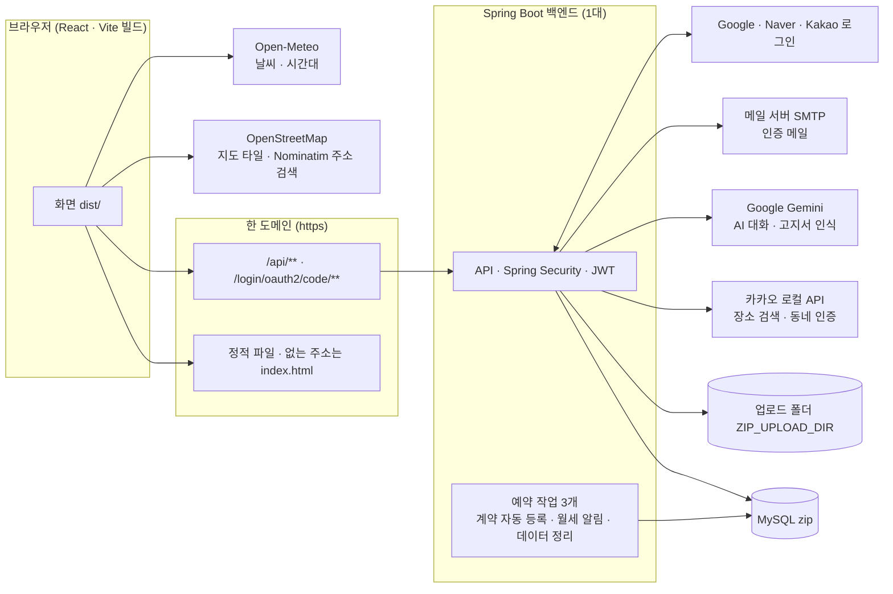

# 앱 구조와 실행 모드

2026-11-24 확인 · [초기 수집 기준](../raw/index.md) · [위키 색인](../index.md)

ZIP의 프론트엔드는 React·TypeScript·Vite로 구성됩니다. 실제 서버 모드에서는 프론트의 `/api` 요청을 Spring Boot 백엔드가 처리합니다. MySQL에는 JdbcTemplate을 기본으로 사용하며, 메모 폴더에 Spring Data JPA를 적용했습니다. DB 변경은 [Flyway 작업](database.md#마이그레이션-정합성-점검)으로 서버 실행 전에 적용합니다. 개발 중 Vite는 `/api` 요청을 `VITE_PROXY_TARGET`으로 보내며 기본 대상은 `http://localhost:8080`입니다. [프론트 안내](../../frontend/README.md) · [Vite 설정](../../frontend/vite.config.ts) · [백엔드 안내](../../backend/README.md)

| 실행 목적 | 시작 위치와 설정 |
| --- | --- |
| 화면 개발·데모 | `frontend/`에서 `npm install` 후 `npm run dev`. 프론트 개발 서버는 기본 3000 포트에서 실행되며 모의 API가 기본값입니다. |
| 서버 연동 개발 | [DB를 준비](database.md)하고 백엔드 로컬 설정을 채운 뒤, `backend/`에서 `./gradlew.bat bootRun`을 실행합니다. 프론트의 `.env.local`에 `VITE_USE_MOCK=false`를 지정합니다. |
| 운영 빌드 | `frontend/`에서 `npm run build`. [Vite 설정](../../frontend/vite.config.ts)이 `VITE_USE_MOCK=false`를 고정해 `.env.local` 값과 관계없이 실제 서버 모드로 빌드됩니다. 모의 빌드는 `VITE_USE_MOCK=true npm run build`처럼 명령에서 덮어쓸 때만 만들어집니다. 빌드 환경변수(`VITE_API_BASE_URL`, `VITE_WEATHER_*`)의 타입은 [환경변수 타입](../../frontend/src/vite-env.d.ts)에 있습니다. 같은 도메인 구성, 새로고침 대비 `index.html` 응답, 빌드 환경변수 표는 [프론트 운영 빌드](../../frontend/README.md#운영-빌드)에 있습니다. 백엔드 jar와 운영 환경변수는 [운영 배포 설정](../../backend/README.md#운영-배포-설정)에 있습니다. |

서버의 로컬 설정에는 DB·JWT와 사용하는 외부 서비스의 환경 변수가 들어갑니다. 실제 설정은 Git에서 제외되는 `application-local.properties` 또는 실행 환경에서 관리합니다. OpenAPI 문서는 [백엔드 OpenAPI](../../backend/openapi.yaml), 화면별 데이터 계약은 [프론트 API 문서](../../frontend/API.md)에서 확인합니다. [백엔드 설정](../../backend/README.md#처음-설정)

## 시스템 구성

운영에서는 화면과 API를 한 도메인에서 내보냅니다. 서버에 CORS 설정이 없고 refresh 쿠키가 같은 출처에서만 동작하기 때문입니다. 백엔드는 한 대만 띄웁니다. 예약 작업 3개(2026-11-28 쓰레기 배출 알림 제거)와 남용 방지 횟수가 서버 메모리에 있기 때문입니다. 지도 타일·주소 검색·날씨는 서버를 거치지 않고 브라우저가 직접 호출합니다(2026-11-27 코드 기준). [운영 배포 설정](../../backend/README.md#운영-배포-설정) · [프론트 운영 빌드](../../frontend/README.md#운영-빌드) · [DB 관계도](../../db/README.md#관계도-erd)

## API 데이터 계약과 DTO

로그인·회원가입·일정 요청은 Java `record`를 사용합니다. 월별 고정 지출과 가계부는 검증한 저장 요청과 조회 응답에 `record`를 사용합니다. 가계부 컨트롤러는 저장 JSON도 요청 DTO로 받습니다. 내 집 정보는 응답 DTO를 반환하고, 첫 주거 설문은 요청 DTO를 받습니다. [로그인 요청](../../backend/src/main/java/com/zip/backend/auth/AuthRequests.java) · [가입 요청](../../backend/src/main/java/com/zip/backend/auth/signup/SignupRequests.java) · [일정 요청](../../backend/src/main/java/com/zip/backend/calendar/CalendarController.java) · [가계부 DTO](ledger-memos.md#가계부-저장-트랜잭션) · [내 집 정보와 설문 DTO](home-info.md#내-집-정보와-첫-주거-설문의-dto)

2026-11-24에 가계부·월별 고정 지출·내 집 정보와 연결된 월급·분류·메모 초안·첫 주거 설문 계약을 서버 구현 기준으로 OpenAPI와 프론트에 반영했습니다. OpenAPI는 수입과 기타 지출을 개별 경로로 표현하며 프론트는 각 종류에 맞는 저장 본문을 사용합니다. 월별 고정 지출의 등록·수정 본문과 내 집 정보·대출·설문 본문도 각각의 API에서 받는 키를 기준으로 정의합니다. [OpenAPI](../../backend/openapi.yaml) · [프론트 API](../../frontend/API.md) · [가계부](ledger-memos.md) · [월별 고정 지출](fixed-expenses.md) · [내 집 정보](home-info.md)

같은 날 [OpenAPI](../../backend/openapi.yaml)를 서버 컨트롤러 전체와 대조해, 빠져 있던 경로 17개와 AI 대화 전체 삭제(공지 · 관리자 공지, 관리자 꿀팁 지정, 관리자 전체 문의, 고지서 사진 인식 · 등록 결정, AI 대화 기록 저장, 프로필 사진 버리기, 지도 저장 리스트, 내 정보 이름 · 생년월일, 내 경고 · 정지 내역, 주변 동네 안내)를 추가하고 서버에 없는 `GET /api/ai/topics`를 지웠습니다. 내 문의 목록은 본인 것만, 문의 쓰기는 201로 서버와 맞췄습니다. 가계부 `/api/ledger/{kind}`는 `income` · `spend` 경로로 나눠 적습니다. [공지](../../backend/src/main/java/com/zip/backend/notice/NoticeController.java) · [고지서 사진](../../backend/src/main/java/com/zip/backend/bills/BillPhotoController.java) · [지도](../../backend/src/main/java/com/zip/backend/map/MapController.java) · [고객센터](../../backend/src/main/java/com/zip/backend/support/SupportController.java)

2026-11-25에 [OpenAPI](../../backend/openapi.yaml)에 남아 있던 서버와 다른 설명 세 개를 서버 코드 기준으로 고쳤습니다. 글 목록 `GET /api/posts`는 `scope`를 생략하면 `all`이고, 읽기에는 동네 인증이 필요 없습니다(인증은 글쓰기 · 댓글 · 공감만). 이메일 가입의 `address`는 선택입니다. `PATCH /api/auth/me`는 프로필 편집, 소셜 첫 동의(주소 선택), 동의 뒤 주소만 변경의 세 가지 모양을 받습니다. [글 목록 기본값](../../backend/src/main/java/com/zip/backend/community/CommunityService.java) · [가입 주소](../../backend/src/main/java/com/zip/backend/auth/signup/SignupService.java) · [내 정보 수정](../../backend/src/main/java/com/zip/backend/auth/AuthController.java)

2026-11-27에 [OpenAPI](../../backend/openapi.yaml)를 다시 서버와 대조했습니다. 경로는 빠지거나 남은 것이 없었습니다. 서버의 가계부 `/api/ledger/{kind}`를 OpenAPI는 수입·지출 경로로 나눠 적고, 소셜 로그인 시작 `/api/oauth2/authorization/{provider}`는 컨트롤러가 아니라 Spring Security가 처리합니다. 응답 DTO 7개는 칸 이름까지 대조해 세 군데를 고쳤습니다. 회원 응답에는 서버가 보내는 `birth`·`banCount`를 넣고, 보내지 않는 `lastLoginAt`을 뺐습니다. 게시글에는 `reported`·`homeTip`을 넣고, 서버 어디서도 보내지 않는 `reportCount`를 뺐습니다. 고정 지출에는 월별 목록의 `homeManaged`를 넣었습니다. [프론트 API 문서](../../frontend/API.md)의 회원 응답 예시도 서버 응답 칸과 같게 맞췄습니다. Map을 반환하는 응답은 칸 이름을 자동으로 대조할 수 없어 이번 범위에서 제외했습니다. [회원 응답](../../backend/src/main/java/com/zip/backend/auth/UserResponse.java) · [게시글 응답](../../backend/src/main/java/com/zip/backend/community/PostResponse.java) · [고정 지출 응답](../../backend/src/main/java/com/zip/backend/bills/BillResponse.java)

오류 응답은 모두 `{ "message" }` 모양입니다. 서비스가 정한 오류는 `code`도 함께 보냅니다. 2026-11-27부터는 서비스가 미리 막지 못한 중복·제약 위반을 409로 보냅니다. 예상하지 못한 오류는 500과 한국어 안내로 보내고, SQL·스택 같은 내부 내용은 서버 로그에만 남깁니다. 로그인·권한 오류는 Spring Security의 401·403 처리에 그대로 넘깁니다. Spring이 상태를 정한 오류(없는 주소 404, 지원하지 않는 메서드 405, 빠진 값·형식 오류 400)는 상태를 유지하고 본문만 같은 모양으로 맞춥니다. [오류 응답 처리](../../backend/src/main/java/com/zip/backend/common/ApiExceptionHandler.java) · [검증](../../backend/src/test/java/com/zip/backend/common/ApiExceptionHandlerTests.java)

### DTO 적용 검토

2026-11-28에 로컬 `backend`의 `0a25818`에서 컨트롤러·서비스와 프론트 타입을 대조한 여섯 영역에, [PR #153](https://github.com/teammzip/project-ZIP/pull/153)의 지도·장소 리뷰 응답을 추가했습니다. 이후 `5574d0a`에서 알림 목록 DTO를 확인하고 해당 커밋을 기준으로 일정 응답 DTO를 적용했습니다.

| 상태 | 경계 | 적용 이유 |
| --- | --- | --- |
| 적용 완료 | 월별 고정 지출 등록·수정 입력과 월별 조회 응답 | 등록에는 `tag`와 선택 `name`이 있고 수정에는 둘 다 없습니다. 검증한 입력과 `items`, `housingItems`, `contractPeriod`를 타입으로 표현합니다. [월별 고정 지출 DTO](fixed-expenses.md#일반-고정-지출의-납부와-해지) |
| 적용 완료 | 가계부 수입·지출 저장 요청과 거래 목록 응답 | `incomeType`은 수입에만 필요하고 금액 상한도 수입·지출이 다릅니다. `LedgerRow`는 월급 플래그와 선택 메모 필드를 반환합니다. [가계부 DTO](ledger-memos.md#가계부-저장-트랜잭션) |
| 적용 완료 | 내 집 정보 응답과 첫 주거 설문 요청 | 중첩 응답과 설문의 `save`·`skip`을 타입으로 표현합니다. [내 집 정보와 설문 DTO](home-info.md#내-집-정보와-첫-주거-설문의-dto) |
| 적용 완료 | 로그인·가입·내 정보·설문 완료의 공통 회원 응답 | [공통 회원 응답 DTO](#공통-회원-응답-dto) |
| 적용 완료 | 커뮤니티 게시글 목록·상세 응답 | [게시글 응답 DTO](community-operations.md#게시글-응답-dto) |
| 적용 완료 | 월급 설정·설문 월급 초안 응답 | 마이페이지 수입 정보의 조회·저장에 `SalarySettingsResponse`를 사용합니다. [월급 설정 응답 DTO](fixed-expenses.md#월급-설정-응답-dto) |
| 적용 완료 | 지도·장소 리뷰 응답 11곳 (2026-11-27) | 장소 목록·분류·AI 검색·저장 리스트·카카오 즐겨찾기·지도 설정은 `PlaceResponse`와 그 안의 `record`로 바꿨습니다. 리뷰 목록·별점 요약·관리자 리뷰 신고는 `PlaceReviewResponse`로 바꿨습니다. 장소의 주소·전화·영업시간·별점과 작성자 프로필은 값이 없으면 키를 생략하지 않고 `null`을 보냅니다. 응답 모양 테스트를 바꾸기 전에 만들어 같은 테스트로 확인했습니다. 임시 MySQL 8.0에서 바꾸기 전·후 서버의 응답 24개를 비교한 결과, 칸 순서 말고는 같았습니다. 지도 설정은 MySQL 전용 문법이라 이 비교로 확인했습니다. [지도 응답 DTO](map-place-ids.md#지도-응답-dto) |
| 적용 완료 | 알림 목록 응답 (2026-11-28) | [알림 목록 DTO와 기존 응답 계약](calendar-notifications.md#알림-목록-응답-dto-검토) |
| 적용 완료 | 일정 목록·검색·등록·수정 응답 (2026-11-28) | [공통 일정 응답 DTO와 기존 응답 계약](calendar-notifications.md#일정-응답-dto) |
| 적용 완료 | 메모 목록·등록·수정 응답 (2026-11-28) | [공통 메모 응답 DTO와 기존 응답 계약](ledger-memos.md#메모-응답-dto) |
| 적용 완료 | 공지 목록·상세·팝업·관리자 등록 및 수정 응답 (2026-11-29) | [공지 응답 DTO](community-operations.md#공지-응답-dto) |

로그인·가입·일정·일반 메모와 가계부 분류 요청은 기존 `record`를 활용할 수 있습니다. 약관 응답도 이미 타입이 있습니다. 회원 게시글 수처럼 작은 고정 응답과 월별 수입 합계처럼 월이 키인 `Map<String, Long>`은 현재 표현으로 충분합니다. 내부 JDBC 행과 서비스 값은 공개 응답에서 의미나 필드가 달라질 때 분리합니다. 프로필 PATCH는 필드 생략과 명시적 `null`을 구별하는 현재 파서를 유지하는 것이 적합합니다. [일반 메모 입력](../../backend/src/main/java/com/zip/backend/memo/MemoService.java) · [가계부 분류](../../backend/src/main/java/com/zip/backend/ledger/LedgerCategoryService.java) · [약관 응답](../../backend/src/main/java/com/zip/backend/legal/TermsController.java) · [프로필 PATCH](../../backend/src/main/java/com/zip/backend/auth/ProfilePatch.java)

알림 받기 설정의 서버 저장은 기존 `SettingsInput`과 `SettingsResponse`를 사용합니다. 내 집 정보 응답도 `SettingsResponse`를 공유하므로 스위치 저장·복원만으로 새 응답 DTO가 필요하지 않습니다. [생활 설정 컨트롤러](../../backend/src/main/java/com/zip/backend/settings/SettingsController.java) · [알림 설정 저장·복원](home-info.md#내-집-정보와-첫-주거-설문의-dto)

#### 후속 DTO 후보

아래 후보는 서버가 고정된 JSON 필드를 `Map<String, Object>`로 조립하고 프론트가 해당 응답을 별도 타입으로 읽는 경계입니다.

| 우선순위 | 경계 | 함께 검증할 계약 |
| --- | --- | --- |
| 후속 | 관리자 회원·제재 이력과 고객센터 문의 응답 | 페이지의 `items`·`hasNext`, 제재 종료·해제 시각, 미답변 문의의 `answer: null`. [회원·제재 응답](../../backend/src/main/java/com/zip/backend/moderation/ModerationService.java#L47) · [문의 응답](../../backend/src/main/java/com/zip/backend/support/SupportService.java#L99) |
| 후속 | AI 대화 목록·메시지 응답 | 메시지 ID·역할·본문·시각과 선택 `card`는 공통 응답 타입으로 표현할 수 있습니다. `card.data`는 카드 유형별 구조를 보존합니다. [AI 응답 조립](../../backend/src/main/java/com/zip/backend/ai/AiService.java#L210) |
| 선택 | 개인 정보 응답과 일정 분류·프리셋 응답 | `/api/me/profile-info`의 조회·수정은 동일한 네 필드를 반환하며 생년월일이 없으면 `null`입니다. 일정 본문 응답과 별개로 분류에는 기본 항목 배열이, 프리셋에는 분류 ID가 포함됩니다. [개인 정보 API](../../backend/src/main/java/com/zip/backend/settings/ProfileInfoController.java#L29) · [일정 분류·프리셋 API](../../backend/src/main/java/com/zip/backend/calendar/CalendarController.java#L42) |

월별 고정 지출은 서비스가 검증한 입력을 `BillInput`의 `record`로 이미 다룹니다. HTTP 컨트롤러에서 받는 원본 `Map`을 바꿀 때는 금액의 JSON 자료형과 허용 필드 규칙을 테스트로 보존합니다. [월별 입력](../../backend/src/main/java/com/zip/backend/bills/BillInput.java) · [월별 저장 API](../../backend/src/main/java/com/zip/backend/bills/BillController.java#L33)

`b20bc2c` 기준으로 월급 설정과 내 집 정보의 응답 DTO는 적용됐으며, 저장 API의 HTTP 본문은 `Map`입니다. 월급 설정 요청을 별도로 타입화할 때는 수령일까지 받는 저장 API와 수령일이 없을 수 있는 첫 설문을 구분합니다. 전체 계약 저장에서 `loan`을 생략하거나 `null`로 보내면 대출을 비활성화하며, 대출 전용 저장은 `loan` 키를 요구하고 비활성화할 때 `null`을 받습니다. [월급 저장 API](../../backend/src/main/java/com/zip/backend/ledger/SalaryController.java) · [설문 월급 처리](fixed-expenses.md#월급-설정-응답-dto) · [내 집 정보 저장 API](../../backend/src/main/java/com/zip/backend/settings/HomeInfoController.java) · [대출 비활성화](../../backend/src/main/java/com/zip/backend/settings/HomeInfoService.java#L131)

적용할 때는 JSON 필드명·자료형·금액 단위·필드 생략과 `null`·검증 오류 상태를 기존 HTTP 테스트로 비교합니다. 요청 `record`가 이미 있는 경계도 API 계약과 대조합니다.

#### 공통 회원 응답 DTO

로그인과 회원가입은 `accessToken`과 `user`를 담은 `LoginResponse`를 반환합니다. 내 정보 조회·수정과 첫 주거 설문 완료 응답은 `UserResponse`를 바로 반환합니다. 회원 ID는 문자열입니다. 로그인 아이디가 없으면 `username`을 생략하고, 동네가 없으면 `region`을 `null`로 보냅니다. `region`은 `id`·`name`(구 이름)과 함께 시·도를 붙인 `fullName`(예: `서울특별시 중구`)을 보냅니다(2026-11-26 추가). 다른 기기에서 동네를 인증해 브라우저에 고른 동네가 없는 회원의 커뮤니티 입장·날씨·지도가 이 값을 씁니다. [동네 선택 순서](service-integrations.md#홈-날씨-위치) · [회원 응답](../../backend/src/main/java/com/zip/backend/auth/UserResponse.java) · [응답 테스트](../../backend/src/test/java/com/zip/backend/AuthIntegrationTests.java) 개인정보 행이 없으면 `birth`를 생략하고, 행에 생년월일이 없으면 명시적 `null`을 보냅니다. 경고가 없으면 `unseenWarnings`는 빈 배열입니다. [회원 DTO](../../backend/src/main/java/com/zip/backend/auth/UserResponse.java) · [회원 응답 조립](../../backend/src/main/java/com/zip/backend/auth/AuthService.java#L187) · [로그인·가입 응답](../../backend/src/main/java/com/zip/backend/auth/AuthSessions.java) · [응답 통합 테스트](../../backend/src/test/java/com/zip/backend/AuthIntegrationTests.java)

#### 월별 고정 지출과 가계부의 DTO 도입 시 확인할 동작

- 월별 고정 지출의 등록·수정은 `200`과 저장한 청구를 반환합니다. 조회 응답의 미납 `paidAt: null`과 `snapshot`을 보존합니다. 사진 고지서 확정도 `registerMonthly`를 호출하므로 같은 등록 검증을 사용할 수 있게 입력 변환을 확인합니다. [월별 API](../../backend/src/main/java/com/zip/backend/bills/BillController.java) · [사진 고지서 등록](../../backend/src/main/java/com/zip/backend/bills/BillService.java#L250) · [월별 등록 통합 테스트](../../backend/src/test/java/com/zip/backend/BillMonthlyWriteTests.java)
- 가계부 등록 `201`, 수정 `204`는 빈 본문으로 반환합니다. 거래 목록에서는 문자열 ID와 월급 플래그를 반환하고, 연결 메모가 없으면 `memoId`와 `memoTitle`을 생략합니다. 저장 서비스의 회원 잠금과 트랜잭션 안에서 메모·월급을 연결하는 흐름은 기존 롤백·동시 저장 테스트로 대조합니다. [가계부 API](../../backend/src/main/java/com/zip/backend/ledger/LedgerController.java) · [가계부 통합 테스트](../../backend/src/test/java/com/zip/backend/LedgerIntegrationTests.java)
- 두 요청은 현재 허용 필드와 실제 정수 값인지 검사합니다. DTO 바인딩에서 알 수 없는 필드를 무시하거나 문자열·소수 금액을 정수로 변환하면 입력 허용 범위가 달라질 수 있으므로 기존 제약을 함께 확인합니다. 계약 기간·납부 완료·회원 소유·월급 연동은 서비스에서 확인하는 업무 조건입니다. [고정 지출 검증](../../backend/src/main/java/com/zip/backend/bills/BillInput.java) · [가계부 저장](../../backend/src/main/java/com/zip/backend/ledger/LedgerService.java)

### DTO와 별도로 검토할 최적화

- 가계부·월급 신규 등록에는 [생성 키](ledger-memos.md#가계부월급-등록의-생성-키)를 적용했습니다. 가계부 수정은 존재 확인과 기존 메모 조회를 한 번으로 줄이는 방안을 검토합니다. 월급 동기화는 자동 기록과 직접 입력 월급의 존재를 월별로 확인하므로 대상 기간에서 이미 등록된 월을 한 번에 조회하는 방식과 비교할 수 있습니다. 목록의 메모·월급 여부 일괄 조회는 이미 반영돼 있습니다. [가계부와 메모](ledger-memos.md#가계부-기록과-회원별-분류) · [가계부 수정](../../backend/src/main/java/com/zip/backend/ledger/LedgerService.java#L149) · [월급 동기화](../../backend/src/main/java/com/zip/backend/ledger/SalaryService.java#L151)
- 고정 지출 등록·수정에서 금액과 납부 날짜는 요청 DTO 변환 때 한 번 파싱합니다. 선택 월과 납부 기한이 속한 월의 검증에서 같은 계약과 저장 시간대를 재사용하는 방안은 후속 후보입니다. [월별 입력 검증](../../backend/src/main/java/com/zip/backend/bills/BillInput.java) · [계약 월 검증](../../backend/src/main/java/com/zip/backend/bills/BillService.java)
- 회원 응답 조립에서 계정 조회와 별도로 생년월일, 설문 상태, 동의 시각, 제재 집계, 미확인 경고, 동네 인증, 프로필을 조회합니다. 실행 시간과 SQL 수를 기록한 뒤 계정과 함께 조회할 단일 행 정보를 검토합니다. 미확인 경고는 여러 건일 수 있어 회원 행이 중복되지 않도록 확인합니다. [회원 응답 조립](../../backend/src/main/java/com/zip/backend/auth/AuthService.java#L187) · [인증 조회](../../backend/src/main/java/com/zip/backend/auth/AuthRepository.java)
- 서버 알림은 프론트에서 60초마다 갱신하도록 설정돼 있습니다. 목록 API는 회원 잠금으로 일정 알림을 동기화하고 납부한 월세 알림을 정리한 뒤 목록과 미읽음 수를 조회합니다. 요청당 SQL 수와 잠금 대기를 측정한 뒤, 일정 변경·납부 시점의 갱신과 날짜 경계를 처리하는 예약 작업으로 쓰기를 옮기는 방안을 검토합니다. 일정 완료·반복 일정, 알림 설정 변경, 납부 취소, 중복 방지와 표시 시각을 함께 확인합니다. [프론트 갱신](../../frontend/src/features/life/notifications.ts#L45) · [알림 목록](../../backend/src/main/java/com/zip/backend/notification/NotificationService.java#L43) · [일정 알림 동기화](../../backend/src/main/java/com/zip/backend/notification/LifeNotificationService.java#L54)
- OpenAPI 스키마와 실제 HTTP 응답을 CI에서 비교하면 필드·자료형·생략·`null` 규칙의 누락을 발견할 수 있습니다. 11월 27일의 [API 계약 점검](#api-데이터-계약과-dto)에서 `User`의 `birth`·`banCount`, `Post`의 `reported`·`homeTip`, `Bill`의 `homeManaged`가 보완됐습니다. 11월 28일 기준 `Comment`의 `reported`·`parentId`는 여전히 응답 스키마에 없습니다. 최상위 댓글의 `parentId`는 실제 응답에 `null`로 포함됩니다. [OpenAPI](../../backend/openapi.yaml) · [게시글과 댓글 응답](../../backend/src/main/java/com/zip/backend/community/PostResponse.java) · [프론트 댓글 타입](../../frontend/src/features/community/server.ts)

## 화면에서 호출하지 않는 API

2026-11-28 로컬 `backend`의 `0a25818` 기준입니다. Spring 컨트롤러의 HTTP 메서드와 경로 매핑 156개를 OpenAPI, `frontend/src`의 실제 서버 요청, 브라우저에서 불러오는 파일 URL, 백엔드 테스트·HTTP 예제·Postman과 대조했습니다. 화면 호출을 확인하지 못한 경로는 19개입니다. 배포 환경의 접근 로그와 저장소 외부 클라이언트의 사용 여부는 확인하지 않았습니다.

[PR #153](https://github.com/teammzip/project-ZIP/pull/153) 반영 후에는 구형 일반 고정 지출 5개와 일정 완료 전용 경로가 삭제됐습니다. AI 대화 한 건 삭제, 지도 저장 리스트 편집, 다른 동네 주변 보기, 알림 받기 저장은 서버 모드 화면에서 호출합니다. 같은 날 이후 AI 대화 목록·삭제는 내 정보에서 AI 화면 왼쪽 목록으로 옮겼고, 다른 동네 보기는 "다른 동네 둘러보기"로 이름을 바꿔 고른 동네의 글까지 보여 줍니다(`GET /api/posts?regionId=`). 같은 날 남아 있던 미호출 API 7개(`GET /api/events/search`, `GET /api/trash-schedules?regionId=`, `POST /api/admin/sanctions/bulk`, `PATCH /api/admin/reports/{id}`, `GET /api/posts/home-tips`, `PUT`·`DELETE /api/admin/posts/{id}/home-tip`)도 지웠습니다(결정: 2026-11-28 작업 대화, 곽성미 — "사용하지 않는 API는 삭제, 사용하거나 바뀐 것은 유지"). 삭제 전에 컨트롤러 매핑 142개를 프론트 요청과 다시 대조했고, 주소를 이어 붙여 부르는 고지서 사진 등록 결정·장소 리뷰 수정·삭제·신고는 사용 중이라 남겼습니다. 홈 꿀팁 지정값(DB `posts.is_home_tip`, 인덱스, 응답 `homeTip`)은 DB 변경이 필요해 남겨 두었고, 이제 바꾸는 API가 없어 항상 기본값입니다. 아래 표와 작업 단위는 삭제 전 검토 기록입니다. 아래 표와 작업 단위는 반영 전 검토 기록입니다. [고정 지출](fixed-expenses.md#일반-고정-지출의-납부와-해지) · [일정·알림](calendar-notifications.md) · [지도](map-place-ids.md#장소-검색과-저장-리스트) · [동네](community-operations.md#동네-글과-조회-집계) · [AI](service-integrations.md)

### 기능이 필요할 때 활용할 API

| API | 현재 상태와 활용 조건 |
| --- | --- |
| `PATCH /api/me/place-lists/{listId}` | 화면에서 저장 리스트를 생성·삭제하고 장소를 넣을 수 있습니다. 기존 리스트의 이름·색상 편집을 추가할 때 활용할 수 있습니다. [지도 컨트롤러](../../backend/src/main/java/com/zip/backend/map/MapController.java#L76) · [저장 화면](../../frontend/src/features/map/components/SaveSheet.tsx) |
| `DELETE /api/ai/conversations/{id}` | 설정의 데이터 초기화는 전체 대화를 지웁니다. 사용자가 대화 한 건을 골라 삭제하는 기능에 활용할 수 있습니다. [AI 컨트롤러](../../backend/src/main/java/com/zip/backend/ai/AiController.java#L60) · [설정 화면](../../frontend/src/pages/my/SettingsPage.tsx) |
| `GET /api/events/search` | 현재 화면은 받은 일정에서 제목을 검색합니다. 일정 전체를 한 번에 받지 않고 기간별로 조회하는 구조로 전환할 때 서버 검색을 검토할 수 있습니다. 현재 서버 검색은 최대 100건을 반환합니다. [일정 검색 서비스](../../backend/src/main/java/com/zip/backend/calendar/CalendarService.java#L67) · [일정 화면](../../frontend/src/features/life/components/CalendarBoard.tsx#L330) |
| `GET /api/regions` | 로그인 없이 시·도와 시·군·구의 ID, 이름, 상위 지역 ID를 조회합니다. 첫 주거 설문의 검색은 브라우저에서 Nominatim을 사용합니다. 서버 ID를 선택하는 행정구역 목록에 활용할 수 있고 동·읍·면이나 상세주소 검색에는 별도 경로가 필요합니다. [지역 목록](../../backend/src/main/java/com/zip/backend/region/RegionController.java#L24) · [설문 주소 검색](../../frontend/src/features/onboarding/AddressSearch.tsx#L30) |
| `GET /api/regions/{id}/neighbors` | 로그인 없이 지정한 지역의 인접 지역을 조회합니다. 현재 ‘주변 동네’ 탭은 로그인 회원의 동네와 이웃을 함께 반환하는 `GET /api/posts/neighbors`를 호출합니다. 사용자가 임의의 지역을 골라 주변을 살펴보는 기능에 활용할 수 있습니다. [인접 지역](../../backend/src/main/java/com/zip/backend/region/RegionController.java#L38) · [커뮤니티 요청](../../frontend/src/features/community/server.ts#L98) |
| `GET /api/trash-schedules?regionId=…` | 임의 지역의 배출표를 조회합니다. 다른 지역을 찾아보는 기능이나 지역별 자료 점검에 활용할 수 있습니다. 현재 일정의 배출표는 회원 주소 기준의 `GET /api/trash-schedules/me`를 호출합니다. [배출표 컨트롤러](../../backend/src/main/java/com/zip/backend/calendar/CalendarController.java#L88) · [일정 배출표](../../frontend/src/features/life/components/TrashScheduleDisclosure.tsx#L36) |
| `POST /api/admin/sanctions/bulk` | 관리자 화면에 일괄 정지 버튼이 있고 대상마다 개별 API를 호출합니다. 서버 일괄 API에 연결하면 최대 100명의 조치를 한 트랜잭션에서 처리하므로 일부만 적용되는 상황을 피할 수 있습니다. [관리자 일괄 정지](../../frontend/src/features/admin/components/AdminConsole.tsx#L218) · [일괄 제재 서비스](../../backend/src/main/java/com/zip/backend/moderation/ModerationService.java#L88) |

### 현재 흐름에서 통합·정리할 후보

| API | 정리 근거와 확인 조건 |
| --- | --- |
| `PATCH /api/events/{id}/done` | 완료 상태는 일반 `PATCH /api/events/{id}`에 `done`을 담아 저장합니다. 서버의 전용 완료 경로도 같은 일정 수정 로직을 호출하므로 정리 우선순위가 높습니다. [일정 서비스](https://github.com/teammzip/project-ZIP/blob/0a25818ccdef3162ecfaa77deaaeb1974567124b/backend/src/main/java/com/zip/backend/calendar/CalendarService.java#L94) · [일정 동기화](../../frontend/src/features/life/calendarSync.ts#L193) |
| `PATCH /api/admin/reports/{id}` | 신고 ID로 대상을 찾고 대상별 신고 처리와 같은 로직을 실행합니다. 관리자 화면은 `PATCH /api/admin/reports?targetType=…&targetId=…`를 사용하므로 정리 우선순위가 높습니다. [신고 처리 서비스](../../backend/src/main/java/com/zip/backend/community/CommunityService.java#L332) · [관리자 요청](../../frontend/src/features/community/useAdminCommunity.ts#L113) |
| `GET /api/posts/home-tips` | 지역에 관계없이 관리자가 지정한 공개 글을 최신순으로 조회합니다. 현재 홈은 `GET /api/posts/popular`로 회원 동네의 공개 글을 조회수순으로 가져옵니다. 관리자 편집 글이 제품 범위에서 빠진다면 지정·해제 경로와 함께 정리할 후보입니다. [홈 표시](../../frontend/src/features/community/components/HomeCommunityPosts.tsx) · [두 목록의 SQL](../../backend/src/main/java/com/zip/backend/community/CommunityRepository.java#L203) |
| `PUT /api/admin/posts/{id}/home-tip` | 공개 글을 홈 꿀팁으로 지정합니다. 인기 글 SQL은 이 지정값을 사용하지 않습니다. [관리자 지정](../../backend/src/main/java/com/zip/backend/community/AdminCommunityController.java#L51) |
| `DELETE /api/admin/posts/{id}/home-tip` | 홈 꿀팁 지정값을 해제합니다. 게시글 자체의 삭제는 별도 경로입니다. [관리자 해제](../../backend/src/main/java/com/zip/backend/community/AdminCommunityController.java#L55) · [지정값 저장](../../backend/src/main/java/com/zip/backend/community/CommunityRepository.java#L407) |
| `GET /api/bills` | 일반 고정 지출 목록을 조회하며 미래 월의 예정액도 다룹니다. 화면의 `GET /api/bills/monthly`는 시간대를 받고 현재·과거 월에 계약 정보와 주거비를 포함한 응답을 줍니다. 기존 호출자의 미래 월 조회 요구를 점검해야 합니다. [이전 조회](https://github.com/teammzip/project-ZIP/blob/0a25818ccdef3162ecfaa77deaaeb1974567124b/backend/src/main/java/com/zip/backend/bills/BillService.java#L115) · [월별 조회](../../backend/src/main/java/com/zip/backend/bills/BillService.java#L31) |
| `POST /api/bills` | 반복 항목을 생성하고 한국 시간 기준 당월에 미납 기록도 생성합니다. 화면의 `POST /api/bills/monthly`는 요청의 월·시간대와 납부 기한을 기준으로 등록합니다. 이전 요청을 옮길 때 월과 기한을 지정해야 합니다. [이전 등록](https://github.com/teammzip/project-ZIP/blob/0a25818ccdef3162ecfaa77deaaeb1974567124b/backend/src/main/java/com/zip/backend/bills/BillService.java#L274) · [월별 등록](../../backend/src/main/java/com/zip/backend/bills/BillService.java#L175) |
| `PATCH /api/bills/{id}` | 항목 이름·분류·기본 금액을 수정합니다. 금액을 바꾸면 조건에 맞는 미납 기록에도 반영합니다. 화면의 월별 수정은 선택 월의 금액·납부 기한·메모를 다뤄 이름·분류 변경을 직접 대체할 수 있는지 확인해야 합니다. [이전 수정](https://github.com/teammzip/project-ZIP/blob/0a25818ccdef3162ecfaa77deaaeb1974567124b/backend/src/main/java/com/zip/backend/bills/BillService.java#L297) · [월별 수정](../../backend/src/main/java/com/zip/backend/bills/BillService.java#L197) |
| `PUT /api/bills/{id}/payments/{month}` | 납부 여부와 금액을 처리하며 조건에 맞으면 미등록 월 기록도 만들 수 있습니다. 화면의 월별 납부 API는 등록된 기록의 `paid`만 바꿉니다. 예전 금액 정정·미등록 월 처리 절차를 월별 등록·수정으로 옮길 수 있는지 확인해야 합니다. [이전 납부](https://github.com/teammzip/project-ZIP/blob/0a25818ccdef3162ecfaa77deaaeb1974567124b/backend/src/main/java/com/zip/backend/bills/BillService.java#L327) · [월별 납부](../../backend/src/main/java/com/zip/backend/bills/BillSettlementService.java#L34) |
| `DELETE /api/bills/{id}` | 당월 기록을 확정한 뒤 반복 항목을 비활성화합니다. 화면에는 선택 월 기록 삭제와 날짜를 지정하는 항목 해지가 각각 있습니다. 이전 경로의 의도는 해지에 가까우므로 호출을 이전할 때 적용일과 미납 예정분의 처리 차이를 확인해야 합니다. [이전 해지](https://github.com/teammzip/project-ZIP/blob/0a25818ccdef3162ecfaa77deaaeb1974567124b/backend/src/main/java/com/zip/backend/bills/BillService.java#L354) · [적용일 해지](../../backend/src/main/java/com/zip/backend/bills/BillSettlementService.java#L79) · [이전 경로의 Postman 예제](https://github.com/teammzip/project-ZIP/blob/0a25818ccdef3162ecfaa77deaaeb1974567124b/backend/postman/fixed-bills.postman_collection.json) |
| `GET /api/me/settings` | 월세·계약 기간·알림 설정·집 주소·동네를 반환합니다. 내 집 화면은 `GET /api/me/home-info`의 `settings`를 통해 같은 서버 읽기 로직을 사용합니다. HTTP 경로를 통합해도 이 내부 읽기 기능은 내 집 정보에 필요합니다. [생활 설정 읽기](../../backend/src/main/java/com/zip/backend/settings/SettingsService.java#L24) · [내 집 정보의 공통 조회](../../backend/src/main/java/com/zip/backend/settings/HomeInfoService.java#L189) |
| `PUT /api/me/settings` | 월세·납부일·계약월·`notiOn`을 함께 받고 선택한 주소·동네를 저장할 수 있습니다. 주거 화면은 전용 API를 사용하며 내 집 정보 저장은 기존 DB의 `noti_on`을 유지합니다. 화면의 알림 스위치는 브라우저 설정을 바꾸고 서버 월세 알림은 DB 값을 읽으므로, 이 경로를 통합할 때 서버 알림 설정과 주소·동네 편집의 저장 경로를 확인해야 합니다. [생활 설정 API](../../frontend/API.md#설정) · [내 집 정보 저장](../../backend/src/main/java/com/zip/backend/settings/HomeInfoService.java#L87) · [알림 스위치](../../frontend/src/features/life/components/MyInfo.tsx#L249) · [월세 알림](../../backend/src/main/java/com/zip/backend/notification/RentReminderService.java#L45) · [Postman](../../backend/postman/life-settings.postman_collection.json) |

`GET /api/files/content/{key}`는 응답에 담긴 URL로 브라우저가 사진을 불러올 때 사용합니다. OAuth 로그인 시작과 `/login/oauth2/code/{provider}` 콜백은 Spring Security에서 처리합니다. [파일 URL 생성](../../backend/src/main/java/com/zip/backend/files/ProfileFileService.java#L135) · [리뷰 사진 표시](../../frontend/src/features/map/components/PlaceReviews.tsx#L233) · [OAuth 설정](../../backend/src/main/java/com/zip/backend/auth/SecurityConfiguration.java#L99) · [소셜 콜백 배포 안내](../../backend/README.md#운영-배포-설정)

### 적용 시 확인할 작업 단위

- **일괄 제재**를 한 요청으로 연결하면 일부만 저장되는 일을 막습니다. 한 대상에서 오류가 나면 나머지 대상도 처리되지 않으므로, 화면에서 실패 이유를 안내하고 대상을 수정해 다시 요청할 수 있어야 합니다. [일괄 제재 서비스](../../backend/src/main/java/com/zip/backend/moderation/ModerationService.java#L87)
- **미등록 월 지출을 등록하면서 납부하는 호출**을 월별 등록과 납부로 옮기면 두 요청이 됩니다. 등록 후 납부 요청이 실패할 수 있으므로, 사용자는 저장된 미납 기록에서 납부만 다시 시도할 수 있어야 합니다. [월별 등록](../../backend/src/main/java/com/zip/backend/bills/BillService.java#L175) · [월별 납부](../../backend/src/main/java/com/zip/backend/bills/BillSettlementService.java#L34)
- **알림 스위치의 서버 저장**을 도입하면 여러 기기와 서버의 알림 생성이 같은 설정을 따를 수 있습니다. 접속할 때 서버 값을 불러오고, 스위치 변경을 저장하지 못했을 때 마지막으로 저장된 상태를 보여 주는 흐름이 필요합니다. [현재 알림 스위치](../../frontend/src/features/life/components/MyInfo.tsx#L243) · [서버 알림 설정 조회](../../backend/src/main/java/com/zip/backend/notification/NotificationRepository.java#L75)

## 인증과 토큰 재발급

성공 시 백엔드는 `/oauth/callback#token=<accessToken>`으로 리디렉션합니다. 프론트는 URL 프래그먼트에서 토큰을 읽고 주소에서 제거한 뒤, 그 토큰으로 `GET /api/auth/me`를 호출합니다. 기존 `?token=...` 주소에 들어오면 주소에서 토큰을 제거하며, 로그인에는 프래그먼트의 토큰만 사용합니다. 실패 메시지는 `?error=...`로 전달됩니다. [API 계약](../../frontend/API.md#소셜-로그인) · [콜백 페이지](../../frontend/src/pages/auth/OAuthCallbackPage.tsx) · [백엔드 리디렉션](../../backend/src/main/java/com/zip/backend/auth/OAuthLoginHandler.java)

소셜 로그인은 `social_accounts`에서 제공자와 제공자 사용자 번호로 ZIP 회원을 찾습니다. 첫 로그인에는 `users.signup_provider`에 가입 제공자를 기록합니다. 회원 탈퇴로 `users` 행을 삭제하면 소셜 연결과 인증 세션도 외래 키로 삭제되며, 같은 소셜 계정으로 다시 로그인하면 새 ZIP 회원이 생성됩니다. 탈퇴 처리는 탈퇴 시각 기록, 영향을 받은 게시글의 공감·댓글 수 갱신, 커밋 이후 업로드 파일 정리도 수행합니다. [소셜 로그인과 탈퇴 처리](../../backend/src/main/java/com/zip/backend/auth/AuthService.java) · [회원과 소셜 연결·세션 스키마](../../db/schema.sql) · [탈퇴 API 계약](../../frontend/API.md#회원-탈퇴)

로그인·가입·소셜 인증 성공 시 서버가 재발급용 HttpOnly 쿠키를 발급합니다. 프론트는 만료에 따른 401 응답에서 `POST /api/auth/refresh`를 호출하고 원래 요청을 재시도합니다. 서버는 재발급 시 DB의 토큰 해시를 교체하며, 로그아웃이나 세션 만료 후에는 같은 세션의 재발급을 거부합니다. 프론트는 같은 세션의 동시 요청을 묶고, 지원 브라우저의 탭 간에는 Web Locks로 갱신을 조정합니다. 로그인 유지 선택 시 브라우저를 다시 열어도 세션 만료 전까지 복원할 수 있습니다. [인증 세션](../../backend/src/main/java/com/zip/backend/auth/AuthSessions.java) · [재발급 쿠키](../../backend/src/main/java/com/zip/backend/auth/RefreshCookie.java) · [인증 초기화](../../frontend/src/app/setupApi.ts) · [프론트 HTTP 처리](../../frontend/src/lib/apiClient.ts)

만료됐거나 로그아웃한 지 하루 지난 세션(`auth_sessions`)과 요청한 지 하루 지난 이메일 인증(`email_verifications`)은 서버가 6시간마다 지웁니다. 세션 행이 없으면 그 토큰은 무효라 결과가 같고, 인증번호(3분) · 인증 완료 값(30분) · 요청 제한(1시간)보다 깁니다(2026-11-24). [오래된 데이터 정리](../../backend/src/main/java/com/zip/backend/maintenance/DataCleanupService.java)

- **비밀번호 로그인 제한**은 15분 안에 누적 실패가 5회에 이르면 15분 동안 잠그고, 누적 횟수와 재시도 가능 시각을 안내합니다. 정상 로그인 또는 이메일 인증을 통한 비밀번호 재설정으로 누적 실패 상태를 초기화합니다. [PR #126](https://github.com/teammzip/project-ZIP/pull/126) · [로그인 제한 구현](../../backend/src/main/java/com/zip/backend/auth/AuthService.java) · [비밀번호 재설정](../../backend/src/main/java/com/zip/backend/auth/recovery/RecoveryService.java)
- **인증 메일 발송 제한**은 이메일 주소마다 1분 1통·1시간 10통에 더해, 같은 IP에서 10분 5통·하루 20통, 서버 전체 시간당 100통·하루 400통입니다(2026-11-25). 주소를 바꿔 가며 보내는 가입 인증 남용을 막고, 메일 계정의 발송 한도에 걸려 모든 회원의 가입·계정 찾기가 멈추는 일을 막습니다. 서버 전체 상한을 먼저 확인해 막힐 요청이 IP 횟수를 쓰지 않으며, IP 제한은 서버 메모리에서 세므로 재시작하면 초기화됩니다. 프록시 뒤에서는 `server.forward-headers-strategy=native`(기본값, 환경 변수 `SERVER_FORWARD_HEADERS_STRATEGY`)로 `X-Forwarded-For`의 실제 IP를 읽습니다. Tomcat은 바로 연결한 곳이 내부 주소일 때만 이 헤더를 믿습니다. 같은 설정으로 `X-Forwarded-Proto: https`면 refresh 쿠키에 Secure가 붙고, 소셜 로그인의 `{baseUrl}`도 https 주소로 만들어집니다(2026-11-27). [프록시 헤더 검증](../../backend/src/test/java/com/zip/backend/ForwardedHeadersTests.java) 숫자는 [백엔드 설정](../../backend/README.md#처음-설정)의 환경 변수로 바꿉니다. [이메일 인증](../../backend/src/main/java/com/zip/backend/auth/emailcheck/EmailAuthService.java) · [IP 제한](../../backend/src/main/java/com/zip/backend/common/IpWindowLimit.java) · [발송 요청](../../backend/src/main/java/com/zip/backend/auth/emailcheck/EmailCheckController.java) · [검증](../../backend/src/test/java/com/zip/backend/RateLimitTests.java)
- **가입과 계정 찾기**는 이메일 인증을 사용합니다. 이메일 가입과 소셜 첫 동의 화면은 주소 입력 없이 진행하며, 주소 입력은 [주거 설문과 내 집 정보](home-info.md#주소와-회원-설정)에서 할 수 있습니다. 서버는 가입과 첫 동의의 약관 버전과 동의 여부를 확인합니다. 2026-11-25에 두 API의 선택 `address`를 실제 요청 처리에 맞춰 문서화했습니다. [OpenAPI](../../backend/openapi.yaml) · [프론트 연동 계약](../../frontend/API.md#회원가입) · [가입 처리](../../backend/src/main/java/com/zip/backend/auth/signup/SignupService.java) · [첫 동의 처리](../../backend/src/main/java/com/zip/backend/auth/AuthController.java)
- **약관 동의 후 회원 주소 변경**은 `PATCH /api/auth/me`로 처리합니다. 서버는 비어 있지 않은 최대 200자의 주소를 저장하고 주소에서 찾은 시·군·구를 회원의 동네에 반영합니다. [회원 주소 변경 API](../../frontend/API.md#회원-주소-변경) · [주소 저장 및 동네 갱신](../../backend/src/main/java/com/zip/backend/auth/AuthService.java)

## 서버 데이터와 브라우저 저장

서버 모드에서 서버가 관리하는 기록은 API 응답을 기준으로 표시합니다. 설정의 ‘내가 쓴 글’은 [본인 게시글 수](community-operations.md#본인-게시글-수)를 참고하세요.

2026-11-28 적용. 홈 지출 위젯과 가계부 기타 지출 화면의 `/api/ledger/spend`는 `['ledger', 회원 ID, 세션, 'spend', 월, 시간대]`와 조회 옵션을 공유합니다. 동시에 조회하면 같은 요청을 공유하며, 화면 이동 후에도 캐시가 남습니다. 앱 기본값인 최신 상태 30초와 미사용 캐시 보관 5분을 사용하며, 화면을 열어 둔 동안 60초마다 재조회합니다. [기타 지출 조회 옵션](../../frontend/src/features/life/ledgerQueries.ts) · [홈 지출](../../frontend/src/features/life/components/HomeWidgets.tsx#L195) · [가계부 조회](../../frontend/src/features/life/components/ServerMoneyLog.tsx#L38) · [앱 조회 기본값](../../frontend/src/lib/queryClient.ts)

기타 지출을 등록·삭제하거나 같은 달에서 수정하면 거래 날짜가 속한 달을, 다른 달로 옮기면 이전 달과 새 달을 무효화합니다. 해당 회원·세션과 영향받은 달의 시간대별 캐시를 모두 갱신 대상으로 삼습니다. 고정 지출 `/api/bills/monthly`는 두 화면이 이미 키를 공유합니다. 금액·납부일 변경이 다른 달의 미납 기록에 전파될 수 있어 기존 갱신 범위를 사용합니다. [기타 지출 저장](../../frontend/src/features/life/components/ServerMoneyLog.tsx#L121) · [공유 요청과 월별 무효화 테스트](../../frontend/tests/ledger.test.mjs) · [월별 고정 지출 조회](../../frontend/src/features/life/components/MonthlyFixedExpense.tsx#L29) · [고정 지출 변경 전파](../../backend/src/main/java/com/zip/backend/bills/BillService.java#L213)

서버 모드의 일정·메모 목록은 공통 `listSync`를 통해 회원별 브라우저 캐시와 서버를 동기화합니다. 가계부의 임시 입력은 [가계부와 메모](ledger-memos.md)를 참고하세요. [일정 동기화](../../frontend/src/features/life/calendarSync.ts) · [메모 동기화](../../frontend/src/features/memo/sync.ts)

생활 관리의 브라우저 저장소는 로그인한 회원별 키를 사용합니다. 계정을 전환하면 화면의 이전 상태를 비우고 해당 회원의 저장본을 불러옵니다. 소유자를 알 수 없는 과거 공용 키는 그대로 둡니다. [계정별 브라우저 저장](../../frontend/src/lib/accountStorage.ts) · [생활 관리 저장소](../../frontend/src/features/life/store.ts)

## 화면 접근과 공통 모달

라우터는 홈·지도·관리자 화면 등을 주소에 처음 접근할 때 불러옵니다. 공개 약관과 동네 목록(`GET /api/regions`, `GET /api/regions/{id}/neighbors`, 2026-11-24)은 로그인 전에도 열 수 있고, 서버는 관리자 API에서 관리자 역할을 검사합니다. [동네 목록 API](../../backend/src/main/java/com/zip/backend/region/RegionController.java) 공통 모달은 열릴 때 내부로 포커스를 옮기고, `Tab`과 `Shift+Tab`을 내부에서 순환시킵니다. 닫으면 기존 조작 요소로 포커스를 돌립니다. [라우터](../../frontend/src/app/router.tsx) · [공통 모달](../../frontend/src/components/ui/Modal.tsx) · [서버 권한](../../backend/src/main/java/com/zip/backend/auth/SecurityConfiguration.java)

화면 코드에서 오류가 나면 최상위 경로의 `errorElement`가 앱 전체의 빈 화면 대신 [오류 화면](../../frontend/src/pages/RouteErrorPage.tsx)을 보여 줍니다(2026-11-25). 화면 파일은 주소에 처음 갈 때 받으므로, 새 버전 배포 뒤 옛 화면을 열어 둔 사용자는 사라진 파일을 받지 못할 수 있습니다. 이 오류는 [옛 파일 판별](../../frontend/src/lib/staleChunk.ts)이 브라우저별 문구로 알아보고, 이 탭에서 10초 안에 다시 하지 않았을 때만 한 번 자동 새로고침합니다. 그 밖의 오류는 새로고침 · 홈으로 가기를 안내하고 개발자 도구에 원인을 남깁니다. [라우터](../../frontend/src/app/router.tsx) · [검증](../../frontend/tests/route-error.test.mjs)

관련 흐름은 [내 집 정보와 대출](home-info.md), [지도 장소 식별자](map-place-ids.md), [배출표 조회](trash-schedules.md)에서 확인할 수 있습니다.
